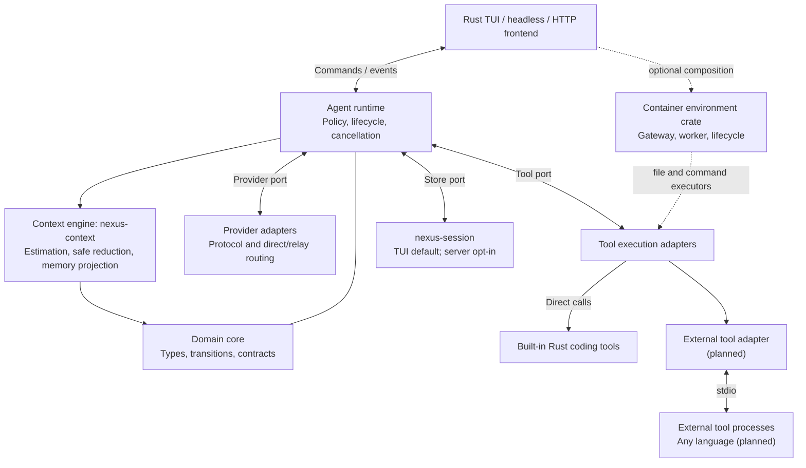
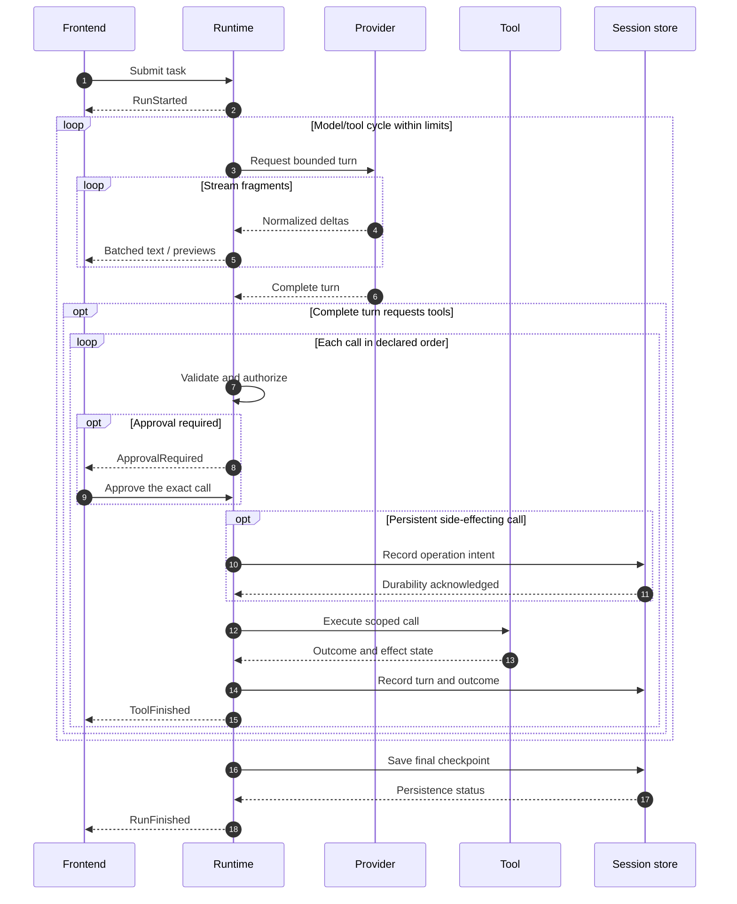

# Nexus Agent

**Fast to start. Small by design. Open to extension.**

[](LICENSE)
[](docs/tasks/08-architecture-migration.md)

A Rust coding agent with live model integrations, native terminal sessions,
coding tools, and optional container execution. Designed around very fast startup
and a minimal core, with broader capabilities in replaceable tools and adapters,
not an ever-growing engine. External plugins remain planned.

<div align="center">

</div>

[Quickstart](QUICKSTART.md) · [Vision](#vision) · [Documentation](docs/index.md) · [Contributing](CONTRIBUTING.md) · [Architecture](#architecture) · [Extensions](#extensions) · [Project status](#project-status)

Developer checks and optional low-value tests: [Testing](docs/testing.md).

> [!IMPORTANT]
> Nexus Agent is **0.2.6-alpha**, with the scoped M0–M4 gates complete over the shared runtime, live Chat Completions, OpenAI Responses, and Anthropic Messages adapters, development-mode file tools, and sandboxed command execution. The TUI and loopback HTTP/SSE server support configured providers; headless remains a scripted test runner. Normal interactive TUI sessions use local persistent storage and support explicit history restoration; the server can optionally persist source and tool-operation records, but has no HTTP restore API. External plugins are not implemented. Real tools default to automatic project/temp operations; external paths need approval, and `--strict-tools` enables stricter confirmation. See [QUICKSTART.md](QUICKSTART.md) for setup and [migration status](docs/tasks/08-architecture-migration.md) for evidence: filesystem and actual sandbox tests now pass on the macOS and Linux reference environments; deliberately detached descendants remain outside the documented cleanup guarantee and their effects are reported as uncertain. **The scoped M0–M4 gates are complete for their recorded scopes; Beta readiness and cross-platform production/security readiness are not claimed.** See [M0 gates](docs/tasks/04-m0-gates.md) for the accepted scope, separately retained first-execution security scan, and deferred cold-cache measurement. The broader architecture below includes planned features, not just implemented ones.

## Vision

**A small, dependable execution core with a memory system that carries forward
the evidence a task needs—not an ever-growing transcript.**

Our research direction is a compiler-inspired semantic-memory system: transform
conversation and tool records into a typed **Semantic IR**, track provenance,
versions, and dependencies, and construct bounded context for the next decision.
Combine graph relationships with retrieval—including vector search—to find
relevant evidence, while retaining losslessly compressed source records for
traceability and on-demand recovery. Explore specialized **LoRA** adapters for
reading and producing the IR, with the goal of helping lightweight models work
reliably on complex, long-running tasks within limited context windows.

This is a **research vision, not an implemented feature or a claim of lossless
semantic compression**. Original records can be recovered only while retained;
structured interpretations can be wrong and must remain correctable. Memory
selection must not grant tool permissions, hide uncertain effects, or replace
execution evidence. Graph/vector databases and model training are optional
research components, not requirements for the Agent Core.

See the [research concept, related papers, and evaluation criteria](docs/research/task-context-compiler.md).

**Context Management is a central engineering priority.** The
[context management design](docs/design/12-context-management.md) records the
minimal source-history/active-context architecture, its path toward the evidence
system above, and a measurable 92K -> 64K -> 32K validation workflow. Conventional
compaction is partly implemented; the complete history separation and evaluation
system remain proposed work, not claims of achieved small-window repair quality.
The current implementation includes adaptive request-estimate calibration and
telemetry, plus summaries prompted to retain investigation state (`Established`,
`Ruled out`, `Open`, `Next`). Those summaries remain untrusted model-generated
text, not verified facts; see the implementation notes in the design document.
The exposed one-task Astropy context-retention replay completed one context
reduction and was resolved by the official evaluator. This single result does
not establish reduced repeated investigation or causation, and is not an overall
benchmark score. The separate SymPy replay triggered no reduction. See the
[reviewed evidence](docs/research/evidence/README.md) and
[run history](docs/research/agent-benchmarks.md).

## Design Goals

| Priority | Direction |
| --- | --- |
| **Fast startup** | Aim for **100 ms** to become locally interactive; the scoped M0 ordinary warm/prepared ceiling is **150 ms per valid launch** on the accepted reference hosts. |
| **Small footprint** | Keep reducing executable size, memory, idle CPU, and background work using measured baselines. |
| **Clear boundaries** | Separate domain logic, execution, integrations, and presentation. |
| **Broad model coverage** | Adapt mainstream protocols without requiring a different SDK for every vendor. |
| **Explicit extensibility** | Support direct Rust tools and cross-language external plugins through narrow contracts. |
| **Concise code** | Keep normal paths direct, failure paths short, and validation at explicit boundaries. |
| **Linux and macOS first** | Treat both as first-release acceptance platforms; defer Windows. |

The startup definition includes local configuration and interface initialization,
not model responses or optional plugin readiness. Measurements below describe
specific reference profiles, **not guarantees on arbitrary hardware**. See the
[performance design](docs/design/05-performance.md).

### Accepted M0 measurements

Scoped M0 acceptance completed on **2026-11-02**. Startup uses default-feature
release TUI builds, rustc **1.99.0**, a 120x40 PTY, isolated HOME/XDG/config,
and an observed composer input response. Reference hosts are macOS arm64
(Apple M4, 16 GiB) and Linux x86_64 (Ubuntu 26.04.1 VM, 4 vCPUs, 7.3 GiB).

| Startup profile | Valid samples | Spawn-to-input-response p50 / p95 / max |
| --- | ---: | ---: |
| macOS, ordinary warm after security scan | 30/30 | 32.326 / 37.895 / 38.804 ms |
| Linux, ordinary warm | 30/30 | 12.394 / 13.933 / 15.510 ms |
| Linux, executable-page prepared | 30/30 | 93.225 / 98.721 / 100.561 ms |
| Linux, independent prepared repeat | 30/30 | 95.710 / 106.960 / 112.951 ms |

The macOS **815.573 ms first execution** correlated with Gatekeeper/XProtect
scanning is retained as a separate owner-approved profile, **not deleted or
claimed to meet 150 ms**. No security checks were disabled. Linux prepared
profiles do not establish cold shared libraries or filesystem metadata; the
strict cold ELF profile has a separate 200 ms criterion and recorded owner
exception. macOS cold-cache measurement remains deferred to M5.

The composed synthetic read-only-tool workflow observed Linux TUI process RSS
high-water of **6,960–7,060 KiB**, below its scoped **128 MiB** cap. This excludes
tool-child memory and is not an allocator/full-session peak. macOS resident-size
maxima are sampled, not kernel peaks; no macOS RSS cap is inferred. Full methods,
binary hashes, idle CPU/wakeup, input/cancellation and queue/dispatch observations
are in the [accepted M0 evidence](docs/tasks/04-m0-gates.md). Fixtures do not
establish real-model throughput or a complete coding-session baseline.

### Native release sizes

Actual local `.tar.gz` artifacts were built with rustc **1.99.0**, locked
dependencies and the standard release profile. These installer-aligned builds
enable `nexus-tui/container` and `nexus-server/container`; they are **not the
default-feature performance binaries above**. All values below are bytes:

| Artifact / installed file | macOS arm64 | Linux x86_64 |
| --- | ---: | ---: |
| `nexus-tui` | 5,935,488 | 6,935,392 |
| `nexus-server` | 4,253,344 | 4,805,376 |
| `nexus-headless` | 2,456,624 | 2,808,864 |
| `nexus-config` | 26,191 | 26,191 |
| Four installed commands, uncompressed | 12,671,647 | 14,575,823 |
| Complete `.tar.gz` archive | 4,700,780 | 5,173,727 |

The archive also includes an offline installer, license and checksum/provenance
manifest. Build records explicitly identify dirty source trees; these are
measured local artifacts, **not published, signed, notarized or reproducible-build
claims**. Extracted installation and command smoke checks passed on both
reference hosts, not on every OS/glibc version. Per-file hashes and build metadata:
[macOS](docs/tasks/evidence/distribution-release-macos-m0-close.json) ·
[Linux](docs/tasks/evidence/distribution-release-linux-m0-close.json).

## Architecture

The first diagram shows the host's in-process core, runtime, frontend, and
adapters; direct in-process tool dispatch does not require plugin IPC (container
tools still use Docker worker transport). `nexus-session` has
file-backed storage and runtime source-history/tool-operation recording. Normal
interactive TUI sessions use it by default and can explicitly restore history;
server persistence is opt-in and has no HTTP restore API;
external plugins are also not implemented. Provider TLS and sandboxed commands
can launch helper processes.



Container-backed execution is isolated in `nexus-container`; ordinary local
filesystem and sandboxed process tools remain in `nexus-tools`.

`nexus-context` is the independent context-processing crate. It owns token
estimation/calibration, safe exchange selection and staged reduction plans, and
untrusted derived-memory projection. It depends only on shared `nexus-core`
types; it cannot call providers, execute tools, or grant permissions. The runtime
owns model invocation (including summaries), cancellation, deadlines, usage and
transactional commits. This is the optimization boundary for future context
work, not an implementation of the Semantic IR, graph/vector retrieval, or LoRA
research described above.

Container execution is an opt-in path in container-enabled TUI/server builds;
the runtime applies its normal authorization and lifecycle controls to the
container-backed tools. It remains a prototype, not an approved isolation
boundary. The topology is shown separately:

```mermaid
flowchart LR
    Runtime["Runtime / frontend<br/>local or opt-in container tools"]
    ContainerTools["Feature-gated container adapters<br/>file tools + host_exec"]
    Session["Internal workload session<br/>lifecycle + quarantine"]
    Transport["Bounded Docker CLI transport"]
    Owner["Owner-only state record<br/>fail-closed on leftovers"]
    Daemon["Local Docker Engine<br/>or Docker Desktop VM"]
    Gateway["Gateway container<br/>nftables + DNS"]
    Workload["Workload container<br/>keeper + worker"]
    Workspace["Selected host workspace<br/>only user-data bind"]

    Runtime -->|"explicit container selection"| ContainerTools
    ContainerTools <--> Session
    Session --> Transport
    Session --> Owner
    Transport <--> Daemon
    Daemon --> Gateway
    Daemon --> Workload
    Workload -. "shares network namespace" .-> Gateway
    Workspace -->|"read/write bind"| Workload
```



Container support is feature-gated and requires explicit startup selection and
images. On Docker Desktop, the gateway detects the platform and permits only
the narrow synthetic `198.18.0.0/15` TCP 80/443 proxy path; configured host/LAN
denies take precedence. The workload overlays `node_modules` and `.next` with
private tmpfs mounts so Linux dependency installation and builds do not reuse
host artifacts. The opt-in public HTTPS and npm-registry probes passed on the
development Docker Desktop host. A production build succeeded in an equivalently
constrained container; the end-to-end Nexus `host_exec` attempt exceeded its
per-tool deadline, so that integration result is inconclusive. This is not
evidence of native Linux host/LAN isolation: native Linux validation remains
outstanding, and the container path must not be treated as an approved isolation
boundary. See the [container design](docs/design/11-container-execution.md),
[gateway checklist](containers/README.md), and [workload image notes](containers/workload/README.md).

In the first diagram, connections show runtime interactions and domain usage,
**not source-code dependency direction**. The composition root injects concrete
adapters; the runtime does not import their implementations. Those boxes are
logical host components, not fixed crate names or separate background services.

- **Domain core:** portable data, state transitions, and contracts; no terminal, HTTP, vendor SDK, or OS-specific types.
- **Runtime:** authoritative run state, execution limits, authorization, cancellation, and ordered events.
- **Adapters:** model protocols, coding tools, plugin transports, and persistence.
- **Frontends:** input and presentation only; neither the TUI nor headless entry point bypasses runtime policy.

See [component boundaries](docs/design/01-components.md) for dependency direction and ownership.

### Agent Execution

The following sequence illustrates the runtime flow with persistence enabled.
Source-history and operation records are implemented; the final checkpoint is
conceptual, not a promise of crash-resumable active execution. Restoring saved
history never resumes an interrupted process or replays tool calls. Denial,
refusal, errors, cancellation, and uncertain effects have explicit outcomes.



Partial tool arguments are previews, never executable instructions. Each runtime has one active run and sequential tool dispatch; separate TUI/server sessions own separate runtimes. Cancellation is not rollback, and uncertain side effects must not be blindly replayed.

## First-Release Defaults

Accepted in [Decision 01](docs/design/decisions/01-first-release-defaults.md); detailed interfaces remain drafts.

| Area | Accepted default |
| --- | --- |
| Permissions | Development mode by default: project/temp operations are automatic, external file access needs approval (allow once or a session-only directory grant); `--strict-tools` keeps project-jailed reads with confirmation for mutations and exec. |
| Frontend | Grok Build-style full-screen Rust TUI plus a headless entry point over the same runtime. |
| Sessions | Normal interactive TUI sessions save locally outside the project; history restoration is explicit. Demo/headless remain ephemeral. The server has an opt-in file store for source and tool-operation records, without HTTP restore APIs. |
| Authentication | API configuration with external credential references; browser login deferred. |
| API relay | Relay is a provider plugin; support existing services first and keep local execution optional. |

## Using the Frontends

All frontends use the same runtime policy boundary, but their wiring differs: the TUI supports live providers and real tools; the server supports live providers with fake tools by default; headless uses scripted fakes only. Read-only mode in the TUI/headless is enforced at tool dispatch, not by convention.

```sh
cargo run -p nexus-headless --locked --offline -- "hello"
cargo run -p nexus-tui --locked --offline -- --tools-root /path/to/project
```

To build a native release archive for the current host (Python 3.11+ and Rust
required; no automatic publication):

```sh
python3 scripts/package-release.py --offline
```

This writes `dist/nexus-agent-<version>-<rust-host-target>.tar.gz` and its
`.sha256` sidecar. It includes container support but no container images; local
execution remains the default. Verify the sidecar before extraction, then use
the included `python3 install.py "$HOME/.local/bin"` for installation without
Cargo. See [release build and installation](QUICKSTART.md#build-and-install-a-native-release-archive)
for platform checks, runtime dependencies and unsigned-artifact limitations.

Configure a model before submitting in the TUI; an unconfigured launch does not silently return fake replies. Provider credentials are resolved on submission, not at startup. The TUI's `demo` Cargo feature is off by default, including in release builds; enable it explicitly to use `--demo`. This permits demo fallback but does not disable real tools or override a selected live model. Its interactive canned prompt runs automatically only when no model is selected. Cargo's `--offline` does not disable runtime API requests. See the [Quickstart](QUICKSTART.md).

### Agent modes

| Mode | Tool policy |
| --- | --- |
| `build` (default) | Full capability; in development mode project/temp operations are automatic while external paths need approval, and `--strict-tools` requires explicit approval for mutations and exec. |
| `plan` | Read-only: mutations, processes, and unclassified tools are denied without prompting; permitted reads still run. |

In the local-execution TUI, `Tab` in the composer cycles modes unless path
completion is open, when it accepts a suggestion. Container execution does not
allow mode switching. The composer border color and title name the active mode.
One-shot headless runs take `--mode plan|build|<custom>`. Further modes come from configuration:

```json
{
  "modes": [{ "id": "review", "label": "Review", "read_only": true }],
  "default_mode": "review"
}
```

This fragment extends a complete user configuration. Built-in ids cannot be redefined, and unknown mode ids or dangling defaults fail explicitly instead of falling back silently. `default_mode` initializes the TUI; headless defaults to `build` unless `--mode` is supplied.

### TUI presentation

Assistant messages render a Markdown subset (headings, emphasis, code, lists, quotes, tables, footnotes, math) with breathing room between blocks, and CJK text wraps by cell width. Tool cards show the exact invocation with the last 10 output lines and expand on click; entry titles are role-colored. The composer has a blinking block caret that overlays text (`Left`/`Right` move it, `Up`/`Down` recall history), and mouse folding is click-only so arrows never disturb the draft. Left-drag selects conversation or composer text and releasing copies it to the clipboard (OSC 52, which most terminals honor); the wheel scrolls, and `Esc` steps back without ever cancelling.

Type `:` in the viewport to open the desktop command line. `:help` opens a scrollable reference dialog with commands, key bindings, application version, platform, active model, and session. Commands execute only after Enter; use `:q` to exit. The viewport supports Vim-style navigation (`j`/`k`, `gg`/`G`, `H`/`M`/`L`, `Ctrl+f`/`b`, `Ctrl+d`/`u`). In the composer, `@` offers project-relative path suggestions; accepting one inserts a literal reference and does not read or attach the file contents.

Use `:model` to select a configured model, and `:session new`, `:session list`, or
`:session switch <target>` to manage up to 16 loaded sessions. `:session` opens
the live/saved session picker; `:session restore <id>` explicitly loads saved
history into a new runtime using current configuration. Normal interactive
sessions persist locally, but active execution and session grants do not survive
restart. Demo sessions remain ephemeral; saving configuration is separate from
session storage.

## Extensions

The extension design gives built-in and external tools one semantic contract, but different transport costs. Only built-in tools are implemented today.

| Path | Integration | Tradeoff |
| --- | --- | --- |
| **Built-in Rust tools** | Compiled modules registered through the tool port | Direct calls, no IPC; implementation changes require rebuilding. |
| **External plugins** | Separate programs connected through an adapter | Any language implementing a supported protocol; additional process and serialization overhead. |

**Nexus considers MCP an outdated integration approach**, not the preferred direction for new external-tool integrations. A `legacy-mcp` external compatibility interface will still be reserved for legacy MCP integrations, kept outside the domain core. This is a planned boundary, not an implemented adapter: protocol versions and optional capabilities have not been selected, and **MCP compliance is not currently claimed**.

API relay is separate from tool plugins: a relay is a provider implementation behind the provider port, not a model-invoked tool. Existing relay services come first; local relay execution remains an optional boundary and never mandatory startup work.

The coding distribution provides scoped reads, listing, and search, full-file
writes, exact-text patches, and command execution. The local backend accepts
`argv` without an implicit shell and denies network access through
`sandbox-exec` on macOS or `bwrap` on Linux. Container-backed `host_exec` accepts
either `argv` or an explicit `shell_command` (Bash); its network policy belongs
to the selected container environment. In local development mode project/temp
operations are automatic and external paths are approval-gated; `--strict-tools`
restores per-call confirmation for every mutation and execution. Container mode
uses its separate workspace-scoped policy. Workflow, context selection, storage,
and frontend replacement retain explicit boundaries without allowing arbitrary
mutation of runtime internals.

**An extensible core does not make every enabled plugin free.** Optional integrations should initialize on demand; heavy dependencies should remain outside the minimal build. Native dynamic-library loading, WASM runtimes, and arbitrary lifecycle hooks are not initial-core goals.

Read the [plugin design](docs/design/04-tool-plugins.md) and [tool contract](docs/contracts/02-tool.md).

## Model Coverage

Coverage is organized by protocol family rather than by a growing list of vendor SDKs.

| Protocol family | Current status |
| --- | --- |
| OpenAI Chat Completions-compatible | Implemented: `chat_completions`, streaming text and tool calls over HTTP/HTTPS. |
| OpenAI Responses | Implemented: `openai_responses`, streaming, function calls, and continuation mapping. |
| Anthropic Messages | Implemented: `anthropic_messages`, content blocks, streaming, and tool use/results. |
| Gemini native APIs | Planned; not implemented. |

Protocol selection is explicit in revision-2 provider configuration and separate from `direct`/`relay` routing. Revision-1 files remain readable as Chat Completions profiles; saves write revision 2. HTTPS uses the system `openssl` TLS bridge with certificate/hostname verification. Responses and Messages coverage is backed by offline fixtures, **not universal live service/model compatibility**. Unsupported continuation/thinking context fails explicitly; a configurable base URL alone does not establish support.

When a Chat Completions provider returns `reasoning_content` or `reasoning`, the local TUI shows it in a collapsed thinking entry; click its header to expand or collapse it. Streaming providers can update it before the response finishes, and saved reasoning may be shown on history restoration. Reasoning can contain sensitive information: it is not emitted to headless or server clients, and expanded content is visible to anyone viewing the terminal. Not all providers or protocols expose a readable trace.

First-release authentication uses API profiles with external credential references. Existing relay services integrate as provider plugins; local relay execution is optional and on demand.

See [model integration](docs/design/03-model-integration.md), [API relay](docs/design/08-api-relay.md), and the [provider contract](docs/contracts/01-provider.md).

## Safety and Trust

The runtime enforces permissions, resource scopes, deadlines, and output limits. Tool access categories come from host registration, not model-visible descriptions. Model output is data, not a permission grant.

The TUI, ordinary server, and scripted headless runner default to one hour per
tool call within a 24-hour run budget; each tool deadline is clamped to the
remaining run budget. TUI and server settings may override these defaults.
Timeouts do not bypass uncertain-effect handling or worker quarantine.
Per-tool expiry is not, by itself, a run-budget failure. The runtime allows a
bounded cleanup grace (up to two seconds, within the remaining run budget)
without extending the tool's execution deadline. If the worker returns, its
result is recorded and the model can continue; cancellation or an exhausted run
budget still stops the run. A worker that remains live after per-tool cleanup
grace is quarantined and records `TimedOut` / `Unknown` / `Uncertain`; the model
can continue, but new tool dispatch is denied (`NotStarted`) while any
quarantined worker remains. Background ownership is retained until the worker
completes. Container transport timeouts can poison the session even after the
host worker returns: killing the
Docker CLI does not establish remote termination, and poisoned tools remain
unavailable. No automatic command retry or container replacement is performed.

Recoverable failures are inputs to the model loop, not automatic run terminals.
Tool failures and denials retain their actual effects and evidence. Provider
access failures use increasing backoff (1, 2, 5, 10, 30, then 60 seconds)
until a response succeeds, the user cancels, or the run deadline expires; failed
access attempts do not consume successful model turns. Numeric `Retry-After`
headers can extend the wait, but never the run deadline. Partial responses never
authorize tools or silently merge into replacement attempts. Explicit user
cancellation stops further model requests, retries, and tool dispatch, including
during backoff. Hard resource limits, unsafe or inconsistent protocol state,
and persistence/integrity failures still stop the run rather than bypassing
safety checks. Stopping a run does not imply that an outstanding worker has
stopped or that its effects were rolled back.

Planned external plugins are explicitly enabled **trusted code**. They are not implemented, and no untrusted-plugin containment is claimed. Local-backend `host_exec` requires an OS sandbox and fails closed when unavailable; it is not a general sandbox for the TUI, all file tools, or future plugins. Container-backed execution uses the separate prototype boundary described above. Linux hardening beyond the recorded reference profile remains unverified, and process-group cleanup cannot prove that all escaped descendants terminated.

The server binds to loopback only. Configured providers or real tools require `--auth-token-env NAME` with a 64-hex-character bearer token. That server-wide token also authorizes approval/control routes; session IDs are not credentials. Loopback HTTP is not encrypted and does not isolate mutually untrusted same-user processes.

The default permission policy and session behavior are accepted; automatic access remains scoped to the project/temp boundary, external paths require exact-call confirmation (once, or a session-only directory grant that never persists), strict mode confirms every mutation and execution, and restored history never replays operations or old grants.

See the [security design](docs/design/06-security.md) and [session recovery contract](docs/contracts/04-session-store.md).

## Benchmark Observations

Selected SWE-bench diagnostics are summarized below. Difficulty uses Verified
dataset labels where available: simple `<15 min fix`, medium `15 min - 1 hour`,
complex `1-4 hours`. These describe estimated human effort, not agent runtime.
DeepSeek V4.1 Flash ran through either DeepSeek API or OpenCode Go; local Qwen
used Qwen3.8-27B IQ3_M with a 92K context window. These are not controlled model
comparisons, leaderboard scores or representative success rates; blind status
was not established. Agent completion is not official resolution.

| Execution / difficulty | Official results and scope |
| --- | --- |
| Single-task — simple | Local Qwen: Django 11099 resolved twice (including a regression rerun). DeepSeek: Sphinx 8595 (API), Astropy 14995 and xarray 4094 (OpenCode Go) resolved. |
| Single-task — medium | Local Qwen: SymPy 20590 and Astropy 12907 resolved in the reported scored runs; earlier reruns/interruption history is separate. OpenCode Go / DeepSeek: Matplotlib 23299 unresolved. |
| Single-task — complex | DeepSeek API: Sphinx 9461 resolved. OpenCode Go / DeepSeek: **3/5 resolved** (pytest 5787, Django 11885 and 16560); Pylint 4551 unresolved/ambiguous, Django 16263 unresolved. The five-task campaign had 5/5 gold preflights pass; pytest was restarted after an interrupted attempt. |
| Single-task — difficulty not established | OpenCode Go / DeepSeek: Django 12700, pytest 7373 and scikit-learn 25570 resolved; Requests 1963 unresolved. DeepSeek API: Pylint 6506 resolved in three context-profile runs, Flask 4992 resolved. Local Qwen: Flask 4992 unresolved; two Pylint attempts interrupted and unscored. These are not additional Verified difficulty-band results. |
| Parallel — simple smoke test | **4 resolved, 1 not run**: SymPy lacked a launcher import-preflight mapping. Four model runs executed concurrently; scoring was sequential. |
| Parallel — simple, 30 tasks | **28 resolved, 1 unresolved, 1 empty patch**. Six sequential groups of five concurrent attempts; 30/30 gold preflights passed. |
| Parallel — medium, 30 tasks (first run) | **20 resolved, 6 unresolved, 2 empty patches, 1 preflight failure, 1 ambiguous evaluation**. Five dynamically refilled workers, then sequential scoring; 30/30 gold preflights passed. |
| Parallel — medium, 30 tasks (rerun after runtime/session fixes) | **23 resolved, 5 unresolved, 2 ambiguous evaluations**, 0 empty patches and 0 missing predictions. Same fixed 30 tasks, model and five-worker shape; 30/30 gold preflights passed. One agent run stopped on delayed backend unavailability but its saved patch was officially resolved. |

All parallel campaigns used OpenCode Go / DeepSeek. They and the five-task
complex campaign used a temporary 120-second provider first-response timeout,
not a changed product default. Repeated tasks above are attempts, not additional
unique tasks; no aggregate score is inferred across these groups. The two medium
runs used the same fixed selection and model but were not a controlled A/B:
runtime, harness, date and host conditions differed, so the higher rerun count is
not evidence that a specific change caused an improvement.

**Failure attribution matters:**

- **Agent/runtime or harness:** the first medium campaign exposed a 256-record
  session operation-history limit despite a 4,096-call run budget (Astropy
  13033), a reported search deadline followed by an unavailable/poisoned worker
  (Astropy 7671), and a Docker preflight timeout before inference (Pylint 6386).
  The rerun produced no session-capacity failure, no preflight failure and no
  empty patch after the bounded journal, gateway-lifecycle and preflight-wait
  hardening. One rerun attempt stopped on delayed backend unavailability but
  still produced an officially resolved patch; that is fail-closed runtime
  behavior, not model success. Simple smoke testing also exposed the missing
  SymPy preflight mapping. These are not evidence that a model's proposed repair
  was correct or incorrect.
- **Model/repair strategy and agent validation:** local Qwen's Flask patch used
  the wrong interface; complex Pylint missed a required importable interface,
  and complex Django retained unnecessary SQL subqueries. The first medium
  campaign's six unresolved patches failed target tests or introduced a
  regression; the rerun had five unresolved patches and two ambiguous official
  results. The simple campaign missed Django's `LEVEL_TAGS` interface and
  produced one empty scikit-learn patch. These show repair/verification
  limitations, but do not isolate model capability from prompting, tools or
  harness behavior.
- **Environment or uncertain cause:** local Pylint was interrupted, including
  an Ollama crash; Requests had certificate-related test failures; the medium
  rerun had two ambiguous official evaluations, Sphinx 10614 (`no_tests_collected`)
  and Pylint 4661 (`missing_module`). Their root causes were not isolated, and
  the first medium run's Pylint 4661 was also ambiguous. Concurrent resource
  contention may contribute to timeouts, but has not been established by a
  controlled comparison. Do not relabel these as resolved or infer an adjusted
  model score.

See the [benchmark history and evaluation](docs/research/agent-benchmarks.md#recent-benchmark-observations)
for individual results, methods, limitations and operational findings.

## Project Status

**Current position: the scoped M0–M4 gates are complete for their recorded
acceptance scopes, with selected M5 capabilities already delivered. M1 is
complete within its documented process-group support boundary; M2–M4 evidence is
tied to the recorded macOS/Linux reference environments. This is Alpha status,
not Beta readiness.**
Development has been capability-driven rather than strictly milestone-ordered:
the real model/tool/container loop and complex task repairs were exercised before
all baseline measurements and acceptance reviews were finished. Implementation
progress and verified readiness are tracked separately. Beta would require
closing the remaining lifecycle-test gaps and repeating release validation at the
release commit.

| Stage | Implementation and remaining acceptance work |
| --- | --- |
| **M0 — Minimal execution baseline** | Accepted for the owner-approved scope on 2026-11-02; cross-platform evidence, separate first-security-scan profile and M5 cold-cache deferral are recorded in the M0 gates. Not production/security certification. |
| **M1 — Correctness and lifecycle** | Complete within the documented process-group support boundary; deliberately detached descendants/sandbox escapes remain explicit non-goals with uncertain effects. |
| **M2 — Permissions and platform boundaries** | Linux and macOS filesystem/sandbox reference tests pass; evidence is profile-specific, not a universal guarantee for all Linux filesystems/distributions. |
| **M3 — Configuration and composition** | Consolidation slices recorded as verified. |
| **M4 — Internal consolidation** | M4.1–M4.3 and their gate verified on the recorded macOS/Linux reference environments; public compatibility contracts are retained. |
| **M5 — On-demand extensions** | Additional provider protocols implemented with offline fixtures; external-tool transport and HTTP/TLS replacement remain deferred. |

M1–M5 refer to the [architecture migration stages](docs/tasks/08-architecture-migration.md),
not sequential product releases or Beta exit criteria. Officially resolved
SWE-bench tasks demonstrate real end-to-end capability, not completion of every
safety, performance, or cross-platform gate. Near-term work is incremental reliability improvement and
acceptance closure, not a core rewrite or adding features merely to advance a
milestone number.

### M5 implementation inventory

M0–M4 are complete within their recorded acceptance scopes; see the
[migration evidence](docs/tasks/08-architecture-migration.md) for details.
Checked entries below identify implemented work, not blanket acceptance or
production readiness. Unchecked entries remain unvalidated or deferred.

#### M5 — Extensions on concrete demand

- [x] **M5.1:** Chat Completions, OpenAI Responses, and Anthropic Messages protocol selection, capability handling, configuration migration, and offline regression fixtures.
- [ ] Universal live compatibility is not established; individual services/models need their own evidence. Gemini native APIs are not implemented.
- [ ] **M5.2, deferred:** External tool transport/plugins and their bounded lifecycle/trust contract.
- [ ] **M5.3, deferred:** HTTP/TLS transport replacement evaluation; the current OpenSSL bridge remains in use.
- [ ] **M5.4, deferred from M0:** macOS cold-cache interactive startup evidence, using an authorized isolated environment and accepted methodology. Warm-cache results do not establish cold performance.

### Additional delivered capabilities

These capabilities extend beyond the original M0 scope and do not redefine the
M1–M5 migration gates above.

- [x] Live configured providers in the TUI/server, scoped file read/list/search/write/patch tools, and local sandboxed command execution.
- [x] Bounded host instructions, context estimation/calibration, transactional compaction, and history projection protecting tool-call pairing and uncertain-effect evidence.
- [x] Normal interactive TUI local persistence and explicit saved-history restoration; optional server source/tool-operation persistence, without HTTP restore APIs.
- [x] Opt-in container gateway/worker/workload composition, workspace tools, explicit shell commands, and lifecycle/quarantine handling.
- [x] SWE-bench preparation, isolated model attempts, worker preflight, heartbeat diagnostics, and separate official scoring, with resolved task evidence above.
- [ ] Native Linux container host/LAN, metadata, IPv6/DNS, public-egress, and lifecycle recovery validation before secure/production-use claims.
- [ ] Recovery of active execution; restoring history does not resume processes or replay uncertain tool calls.
- [ ] Semantic IR, graph/vector retrieval, and LoRA research components; these remain a vision, not shipped features.

Windows and untrusted-plugin isolation are separate follow-up work. Build from source with `cargo build --workspace --release --locked --offline` (produces `nexus-headless`, `nexus-tui`, and `nexus-server` once dependencies are cached). The **0.2.6-alpha** version is not a stable-release or production-readiness claim.

## Documentation and Contributions

Start with the [documentation index](docs/index.md). Proposed implementation work should respect the confirmed direction and review the relevant draft contract before treating it as a stable interface.

See [CONTRIBUTING.md](CONTRIBUTING.md) for setup, checks, and pull-request guidance. Bug reports, feature proposals, and performance regressions have dedicated [GitHub Issue forms](.github/ISSUE_TEMPLATE/).

| Start here | Purpose |
| --- | --- |
| [Project foundation](docs/design/decisions/00-project-foundation.md) | Confirmed goals and scope. |
| [First-release defaults](docs/design/decisions/01-first-release-defaults.md) | Accepted permissions, UI, sessions, entry points, authentication, relay scope, and code simplicity. |
| [TUI and headless frontends](docs/design/07-tui.md) | Grok Build-style layout, approvals, history, and script entry point. |
| [API relay](docs/design/08-api-relay.md) | Relay provider plugins and existing-service/local-executor boundaries. |
| [Implementation readiness](docs/design/09-implementation-readiness.md) | Engineering gates, M0 acceptance, and concise-code review. |
| [Architecture migration](docs/tasks/08-architecture-migration.md) | Implemented consolidation slices, protocol extension evidence, and platform blockers. |
| [Agent reliability follow-up](docs/tasks/09-agent-reliability.md) | Prioritized work on convergence, verification, experiment reliability, and context-reduction evaluation. |
| [Semantic-memory research](docs/research/task-context-compiler.md) | Compiler-inspired Semantic IR, hybrid retrieval, graph relationships, and LoRA research; not an accepted architecture or implemented capability. |
| [Overview](docs/design/00-overview.md) | First-release boundaries and non-goals. |
| [Common contract](docs/contracts/00-common.md) | Identifiers, outcomes, errors, limits, and compatibility. |
| [Commands and events](docs/contracts/03-command-events.md) | Frontend/runtime interaction and backpressure. |
| [Configuration](docs/contracts/05-configuration.md) | Profiles, secrets, permissions, and bounded defaults. |
| [Engineering guidelines](AGENTS.md) | Repository working conventions. |

## License

[MIT](LICENSE) · Copyright (c) 2026 Lam K.
