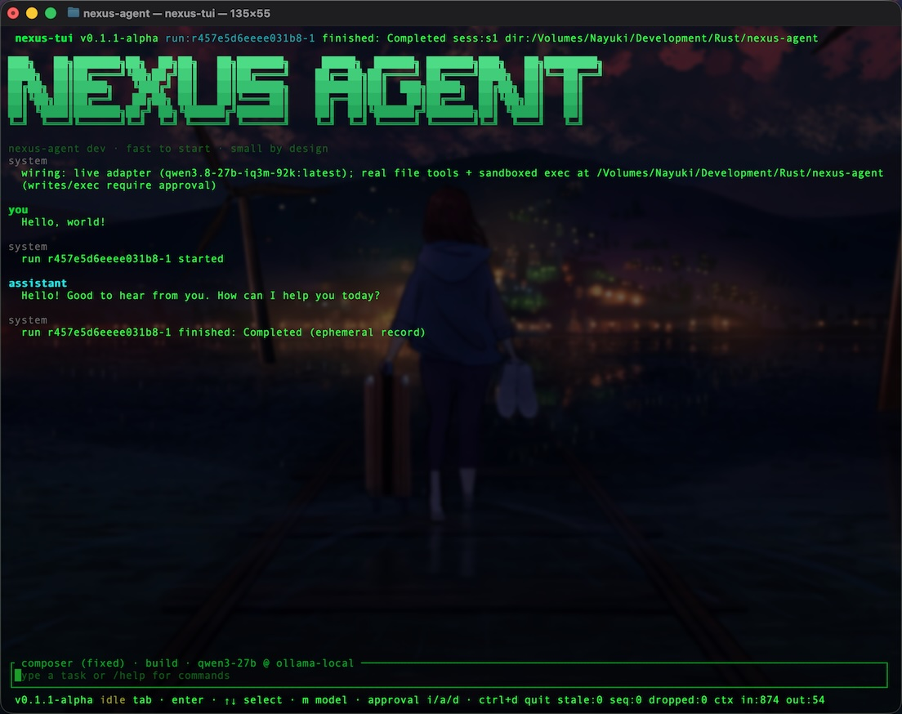
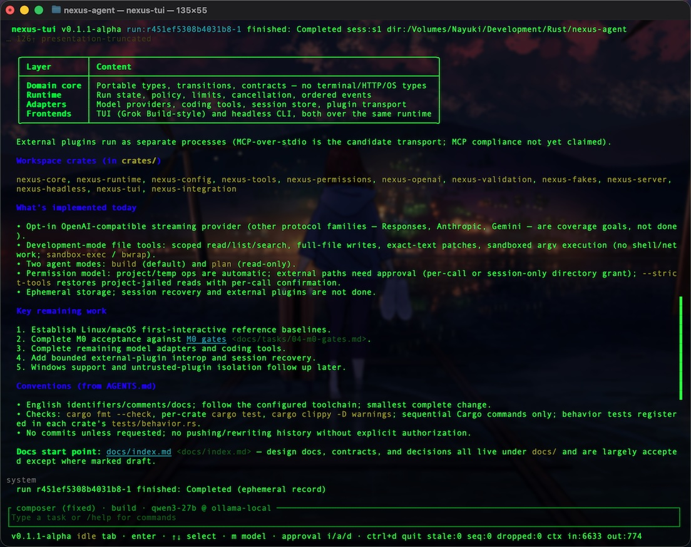
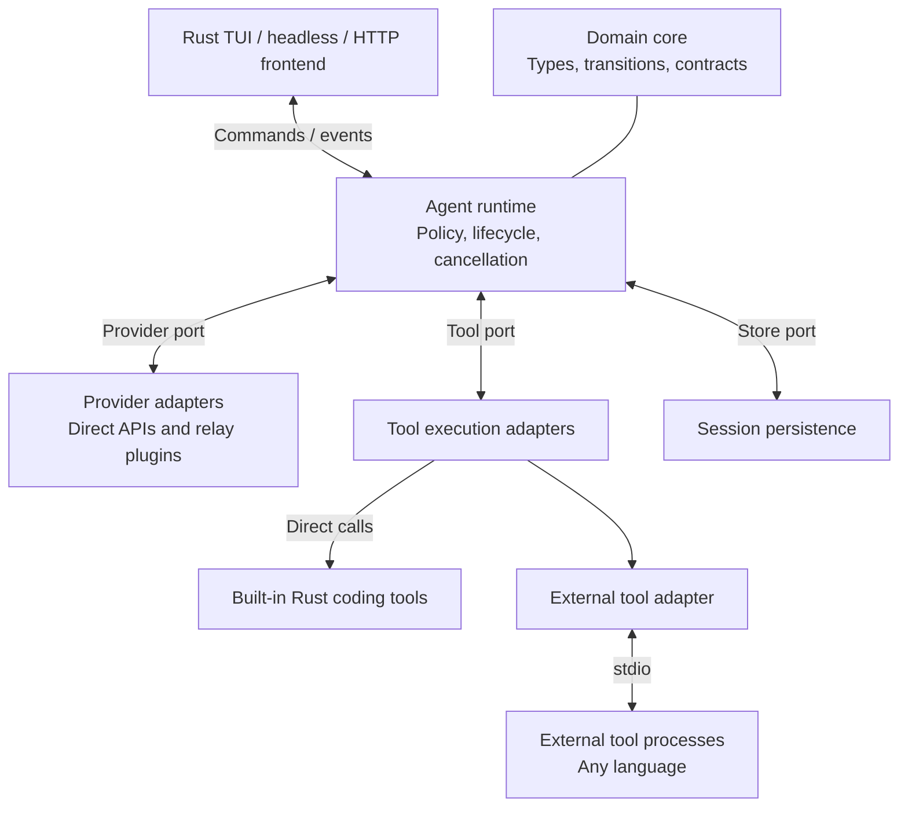
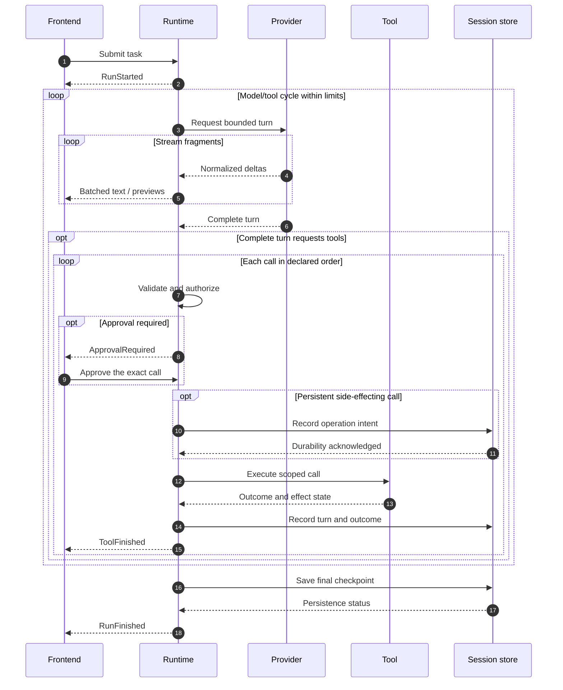

# Nexus Agent

**Fast to start. Small by design. Open to extension.**

[](LICENSE)
[](docs/tasks/08-architecture-migration.md)

A Rust coding agent designed around very fast startup, a minimal core, and a native terminal interface. Broader capabilities belong in replaceable tools and plugins, not an ever-growing engine.

<div align="center">

</div>

[Quickstart](QUICKSTART.md) · [Documentation](docs/index.md) · [Contributing](CONTRIBUTING.md) · [Architecture](#architecture) · [Extensions](#extensions) · [Project status](#project-status)

Developer checks and optional low-value tests: [Testing](docs/testing.md).

> [!IMPORTANT]
> Nexus Agent is **0.2.1-alpha**, built on the M0 runtime with live Chat Completions, OpenAI Responses, and Anthropic Messages adapters, development-mode file tools, and sandboxed command execution. The TUI and loopback HTTP/SSE server support configured providers; headless remains a scripted test runner. Conversation history is memory-only and external plugins are not implemented. Real tools default to automatic project/temp operations; external paths need approval, and `--strict-tools` enables stricter confirmation. See [QUICKSTART.md](QUICKSTART.md) for setup and [migration status](docs/tasks/08-architecture-migration.md) for evidence: current consolidation is verified on macOS, with Linux filesystem/sandbox validation still blocked and descendant cleanup limitations unresolved. **Neither M0 acceptance nor cross-platform security readiness is complete.** The broader architecture below includes planned features, not just implemented ones.

## Screenshots

<div align="center">
<table>
<tr>
<td align="center" width="50%">

<br />
<sub>Title screen — live adapter, sandboxed exec, first reply</sub>
</td>
<td align="center" width="50%">

<br />
<sub>Conversation view — architecture, status, and remaining work</sub>
</td>
</tr>
</table>
</div>

## Design Goals

| Priority | Direction |
| --- | --- |
| **Fast startup** | Target at most **100 ms** to become locally interactive in the first release, and keep reducing startup time. |
| **Small footprint** | Keep reducing executable size, memory, idle CPU, and background work using measured baselines. |
| **Clear boundaries** | Separate domain logic, execution, integrations, and presentation. |
| **Broad model coverage** | Adapt mainstream protocols without requiring a different SDK for every vendor. |
| **Explicit extensibility** | Support direct Rust tools and cross-language external plugins through narrow contracts. |
| **Concise code** | Keep normal paths direct, failure paths short, and validation at explicit boundaries. |
| **Linux and macOS first** | Treat both as first-release acceptance platforms; defer Windows. |

The startup target includes local configuration and interface initialization, but not model responses or optional plugin readiness. It is a goal for documented reference environments, **not a measured result or a guarantee on arbitrary hardware**. See the [performance design](docs/design/05-performance.md).

### Historical executable sizes

Previously recorded optimized, unstripped Cargo release binaries on **macOS arm64** (`cargo build -p nexus-headless -p nexus-tui --release --locked --offline`); these have **not been re-measured for 0.2.1-alpha**:

| Executable | File size |
| --- | ---: |
| `nexus-headless` | 1,674,336 bytes (1.60 MiB) |
| `nexus-tui` | 3,480,752 bytes (3.32 MiB) |
| Both binaries | 5,155,088 bytes (4.92 MiB) |

These are platform- and build-profile-specific file sizes, not compressed download sizes or cross-platform guarantees. We will continue working to keep Nexus Agent lightweight and fast; the 100 ms first-interactive startup target remains a goal, and measurements for it are still pending.

### Current server size measurements

Measured on **macOS arm64** for `nexus-server --features container` (Mach-O):

| Release profile | File size |
| --- | ---: |
| Default Cargo release | 3,116,512 bytes (2.97 MiB) |
| Default release, copied and stripped with `strip -x` | 2,537,160 bytes (2.42 MiB) |
| `opt-level = "s"`, LTO, one codegen unit, symbols stripped | 1,499,664 bytes (1.43 MiB) |
| `opt-level = "z"`, LTO, one codegen unit, symbols stripped | 1,206,112 bytes (1.15 MiB) |

The optimized variants were comparison builds only; repository build profiles were not changed. They compiled successfully, but runtime performance and the full test suite were not measured for these profiles. `opt-level = "z"` is the smallest measured build, not yet a production default. Sizes are platform-specific executable file sizes, not download or installed-package sizes.

## Architecture

The first diagram shows the host's in-process core, runtime, frontend, and
adapters; built-in tools do not pay an IPC cost. It includes planned durable
storage and external plugins, which are not implemented. Provider TLS and
sandboxed commands can launch helper processes.



Container execution is an opt-in path in container-enabled TUI/server builds;
the runtime applies its normal authorization and lifecycle controls to the
container-backed tools. It remains a prototype, not an approved isolation
boundary. The topology is shown separately:

```mermaid
flowchart LR
    Runtime["Runtime / frontend<br/>local or opt-in container tools"]
    ContainerTools["Feature-gated container adapters<br/>file tools + host_exec"]
    Session["Internal workload session<br/>lifecycle + quarantine"]
    Transport["Bounded Docker CLI transport"]
    Owner["Owner-only state record<br/>fail-closed on leftovers"]
    Daemon["Local Docker Engine<br/>or Docker Desktop VM"]
    Gateway["Gateway container<br/>nftables + DNS"]
    Workload["Workload container<br/>keeper + worker"]
    Workspace["Selected host workspace<br/>only user-data bind"]

    Runtime -->|"explicit container selection"| ContainerTools
    ContainerTools <--> Session
    Session --> Transport
    Session --> Owner
    Transport <--> Daemon
    Daemon --> Gateway
    Daemon --> Workload
    Workload -. "shares network namespace" .-> Gateway
    Workspace -->|"read/write bind"| Workload
```



Container support is feature-gated and requires explicit startup selection and
images. On Docker Desktop, the gateway detects the platform and permits only
the narrow synthetic `198.18.0.0/15` TCP 80/443 proxy path; configured host/LAN
denies take precedence. The workload overlays `node_modules` and `.next` with
private tmpfs mounts so Linux dependency installation and builds do not reuse
host artifacts. The opt-in public HTTPS and npm-registry probes passed on the
development Docker Desktop host. A production build succeeded in an equivalently
constrained container; the end-to-end Nexus `host_exec` attempt exceeded its
per-tool deadline, so that integration result is inconclusive. This is not
evidence of native Linux host/LAN isolation: native Linux validation remains
outstanding, and the container path must not be treated as an approved isolation
boundary. See the [container design](docs/design/11-container-execution.md),
[gateway checklist](containers/README.md), and [workload image notes](containers/workload/README.md).

In the first diagram, connections show runtime interactions and domain usage,
**not source-code dependency direction**. The composition root injects concrete
adapters; the runtime does not import their implementations. Those boxes are
logical host components, not fixed crate names or separate background services.

- **Domain core:** portable data, state transitions, and contracts; no terminal, HTTP, vendor SDK, or OS-specific types.
- **Runtime:** authoritative run state, execution limits, authorization, cancellation, and ordered events.
- **Adapters:** model protocols, coding tools, plugin transports, and persistence.
- **Frontends:** input and presentation only; neither the TUI nor headless entry point bypasses runtime policy.

See [component boundaries](docs/design/01-components.md) for dependency direction and ownership.

### Agent Execution

The following sequence illustrates the proposed persistent run, not today's ephemeral storage. Denial, refusal, errors, cancellation, and uncertain effects have explicit outcomes in the contracts.



Partial tool arguments are previews, never executable instructions. Each runtime has one active run and sequential tool dispatch; separate TUI/server sessions own separate runtimes. Cancellation is not rollback, and uncertain side effects must not be blindly replayed.

## First-Release Defaults

Accepted in [Decision 01](docs/design/decisions/01-first-release-defaults.md); detailed interfaces remain drafts.

| Area | Accepted default |
| --- | --- |
| Permissions | Development mode by default: project/temp operations are automatic, external file access needs approval (allow once or a session-only directory grant); `--strict-tools` keeps project-jailed reads with confirmation for mutations and exec. |
| Frontend | Grok Build-style full-screen Rust TUI plus a headless entry point over the same runtime. |
| Sessions | Target: save automatically outside the project; restore history only on explicit request. Current history is memory-only. |
| Authentication | API configuration with external credential references; browser login deferred. |
| API relay | Relay is a provider plugin; support existing services first and keep local execution optional. |

## Using the Frontends

All frontends use the same runtime policy boundary, but their wiring differs: the TUI supports live providers and real tools; the server supports live providers with fake tools by default; headless uses scripted fakes only. Read-only mode in the TUI/headless is enforced at tool dispatch, not by convention.

```sh
cargo run -p nexus-headless --locked --offline -- "hello"
cargo run -p nexus-tui --locked --offline -- --tools-root /path/to/project
```

Configure a model before submitting in the TUI; an unconfigured launch does not silently return fake replies. `--demo` permits demo fallback but does not disable real tools or override a selected live model. Cargo's `--offline` does not disable runtime API requests. See the [Quickstart](QUICKSTART.md).

### Agent modes

| Mode | Tool policy |
| --- | --- |
| `build` (default) | Full capability; in development mode project/temp operations are automatic while external paths need approval, and `--strict-tools` requires explicit approval for mutations and exec. |
| `plan` | Read-only: mutations, processes, and unclassified tools are denied without prompting; permitted reads still run. |

In the TUI, `Tab` in the composer cycles modes, and the composer border color and title name the active one. One-shot headless runs take `--mode plan|build|<custom>`. Further modes come from configuration:

```json
{
  "modes": [{ "id": "review", "label": "Review", "read_only": true }],
  "default_mode": "review"
}
```

This fragment extends a complete user configuration. Built-in ids cannot be redefined, and unknown mode ids or dangling defaults fail explicitly instead of falling back silently. `default_mode` initializes the TUI; headless defaults to `build` unless `--mode` is supplied.

### TUI presentation

Assistant messages render a Markdown subset (headings, emphasis, code, lists, quotes, tables, footnotes, math) with breathing room between blocks, and CJK text wraps by cell width. Tool cards show the exact invocation with the last 10 output lines and expand on click; entry titles are role-colored. The composer has a blinking block caret that overlays text (`Left`/`Right` move it, `Up`/`Down` recall history), and mouse folding is click-only so arrows never disturb the draft. Left-drag selects conversation or composer text and releasing copies it to the clipboard (OSC 52, which most terminals honor); the wheel scrolls, and `Esc` steps back without ever cancelling.

Type `:` in the viewport to open the desktop command line. `:help` opens a scrollable reference dialog with commands, key bindings, application version, platform, active model, and session. Commands execute only after Enter; use `:q` to exit. The viewport supports Vim-style navigation (`j`/`k`, `gg`/`G`, `H`/`M`/`L`, `Ctrl+f`/`b`, `Ctrl+d`/`u`). In the composer, `@` offers project-relative path suggestions; accepting one inserts a literal reference and does not read or attach the file contents.

Use `:model` to select a configured model, and `:session new`, `:session list`, or `:session switch <target>` to manage up to 16 in-memory sessions. Restarting loses conversations and session grants; saving configuration is not durable session storage.

## Extensions

The extension design gives built-in and external tools one semantic contract, but different transport costs. Only built-in tools are implemented today.

| Path | Integration | Tradeoff |
| --- | --- | --- |
| **Built-in Rust tools** | Compiled modules registered through the tool port | Direct calls, no IPC; implementation changes require rebuilding. |
| **External plugins** | Separate programs connected through an adapter | Any language implementing a supported protocol; additional process and serialization overhead. |

MCP over stdio is the preferred initial external-tool transport candidate, kept outside the domain core. Protocol versions and optional capabilities have not been selected, and **MCP compliance is not currently claimed**.

API relay is separate from tool plugins: a relay is a provider implementation behind the provider port, not a model-invoked tool. Existing relay services come first; local relay execution remains an optional boundary and never mandatory startup work.

The initial coding distribution provides scoped reads, listing, and search, full-file writes, exact-text patches, and sandboxed `argv` execution without a shell or network access (`sandbox-exec` on macOS, `bwrap` on Linux). In development mode project/temp operations are automatic and external paths are approval-gated; `--strict-tools` restores per-call confirmation for every mutation and execution. Workflow, context selection, storage, and frontend replacement retain explicit boundaries without allowing arbitrary mutation of runtime internals.

**An extensible core does not make every enabled plugin free.** Optional integrations should initialize on demand; heavy dependencies should remain outside the minimal build. Native dynamic-library loading, WASM runtimes, and arbitrary lifecycle hooks are not initial-core goals.

Read the [plugin design](docs/design/04-tool-plugins.md) and [tool contract](docs/contracts/02-tool.md).

## Model Coverage

Coverage is organized by protocol family rather than by a growing list of vendor SDKs.

| Protocol family | Current status |
| --- | --- |
| OpenAI Chat Completions-compatible | Implemented: `chat_completions`, streaming text and tool calls over HTTP/HTTPS. |
| OpenAI Responses | Implemented: `openai_responses`, streaming, function calls, and continuation mapping. |
| Anthropic Messages | Implemented: `anthropic_messages`, content blocks, streaming, and tool use/results. |
| Gemini native APIs | Planned; not implemented. |

Protocol selection is explicit in revision-2 provider configuration and separate from `direct`/`relay` routing. Revision-1 files remain readable as Chat Completions profiles; saves write revision 2. HTTPS uses the system `openssl` TLS bridge with certificate/hostname verification. Responses and Messages coverage is backed by offline fixtures, **not universal live service/model compatibility**. Unsupported continuation/thinking context fails explicitly; a configurable base URL alone does not establish support.

First-release authentication uses API profiles with external credential references. Existing relay services integrate as provider plugins; local relay execution is optional and on demand.

See [model integration](docs/design/03-model-integration.md), [API relay](docs/design/08-api-relay.md), and the [provider contract](docs/contracts/01-provider.md).

## Safety and Trust

The runtime enforces permissions, resource scopes, deadlines, and output limits. Tool access categories come from host registration, not model-visible descriptions. Model output is data, not a permission grant.

Planned external plugins are explicitly enabled **trusted code**. They are not implemented, and no untrusted-plugin containment is claimed. Built-in `host_exec` requires an OS sandbox and fails closed when unavailable; it is not a general sandbox for the TUI, all file tools, or future plugins. Linux hardening remains unverified, and process-group cleanup cannot prove that all escaped descendants terminated.

The server binds to loopback only. Configured providers or real tools require `--auth-token-env NAME` with a 64-hex-character bearer token. That server-wide token also authorizes approval/control routes; session IDs are not credentials. Loopback HTTP is not encrypted and does not isolate mutually untrusted same-user processes.

The default permission policy and session behavior are accepted; automatic access remains scoped to the project/temp boundary, external paths require exact-call confirmation (once, or a session-only directory grant that never persists), strict mode confirms every mutation and execution, and restored history never replays operations or old grants.

See the [security design](docs/design/06-security.md) and [session recovery contract](docs/contracts/04-session-store.md).

## Project Status

- [x] MIT license and confirmed project direction.
- [x] Draft architecture, performance, security, and interface contracts.
- [x] First-release defaults for permissions, TUI, sessions, entry points, authentication, relay scope, and code simplicity.
- [x] Review and accept the minimal implementation contracts ([M0 lock](docs/tasks/06-m0-lock.md)).
- [x] Implement the shared runtime, live TUI, loopback HTTP/SSE server, scripted headless runner, file read/list/search/write/patch, and sandboxed exec.
- [x] Implement Chat Completions, OpenAI Responses, and Anthropic Messages adapters with explicit protocol configuration and offline regression fixtures.
- [x] Implement M4 consolidation slices: shared ordered-event consumption, tool composition, and current provider capability handling. The default-feature workspace suite has recorded passing macOS evidence; see [migration status](docs/tasks/08-architecture-migration.md) and [Testing](docs/testing.md).
- [x] Add an opt-in container worker/gateway/workload path with runtime authorization and TUI/server selection. It is not a validated isolation boundary: native Linux host/LAN, metadata, IPv6/DNS, and public-egress checks remain outstanding. Image build and keeper-only smoke test are not isolation evidence.
- [ ] Establish Linux and macOS reference baselines: only historical spawn-to-exit characterization exists, which is not first-interactive startup evidence; RSS results are method-confounded, and PTY, idle-CPU, streaming, buffer high-water, and dispatch measurements are pending.
- [ ] Complete M0 acceptance against the [M0 gates](docs/tasks/04-m0-gates.md). Gates were executed historically, but the acceptance checklist is incomplete and its evidence is under repair pending coordinator review.
- [ ] Close migration gates: Linux file race/metadata and sandbox-isolation validation remain blocked; escaped-descendant cleanup remains unresolved. Temporary macOS-only development scope is not cross-platform acceptance.
- [ ] Verify live compatibility for individual services/models and extend protocol coverage as needed; Gemini is not implemented.
- [ ] Add bounded external-plugin interoperability and session recovery.
- [ ] Complete native Linux container network/isolation validation and lifecycle recovery before treating opt-in container mode as suitable for secure or production workloads.

Windows and untrusted-plugin isolation are separate follow-up work. Build from source with `cargo build --workspace --release --locked --offline` (produces `nexus-headless`, `nexus-tui`, and `nexus-server` once dependencies are cached). The alpha version is not a stable-release or production-readiness claim.

## Documentation and Contributions

Start with the [documentation index](docs/index.md). Proposed implementation work should respect the confirmed direction and review the relevant draft contract before treating it as a stable interface.

See [CONTRIBUTING.md](CONTRIBUTING.md) for setup, checks, and pull-request guidance. Bug reports, feature proposals, and performance regressions have dedicated [GitHub Issue forms](.github/ISSUE_TEMPLATE/).

| Start here | Purpose |
| --- | --- |
| [Project foundation](docs/design/decisions/00-project-foundation.md) | Confirmed goals and scope. |
| [First-release defaults](docs/design/decisions/01-first-release-defaults.md) | Accepted permissions, UI, sessions, entry points, authentication, relay scope, and code simplicity. |
| [TUI and headless frontends](docs/design/07-tui.md) | Grok Build-style layout, approvals, history, and script entry point. |
| [API relay](docs/design/08-api-relay.md) | Relay provider plugins and existing-service/local-executor boundaries. |
| [Implementation readiness](docs/design/09-implementation-readiness.md) | Engineering gates, M0 acceptance, and concise-code review. |
| [Architecture migration](docs/tasks/08-architecture-migration.md) | Implemented consolidation slices, protocol extension evidence, and platform blockers. |
| [Overview](docs/design/00-overview.md) | First-release boundaries and non-goals. |
| [Common contract](docs/contracts/00-common.md) | Identifiers, outcomes, errors, limits, and compatibility. |
| [Commands and events](docs/contracts/03-command-events.md) | Frontend/runtime interaction and backpressure. |
| [Configuration](docs/contracts/05-configuration.md) | Profiles, secrets, permissions, and bounded defaults. |
| [Engineering guidelines](AGENTS.md) | Repository working conventions. |

## License

[MIT](LICENSE) · Copyright (c) 2026 Lam K.
