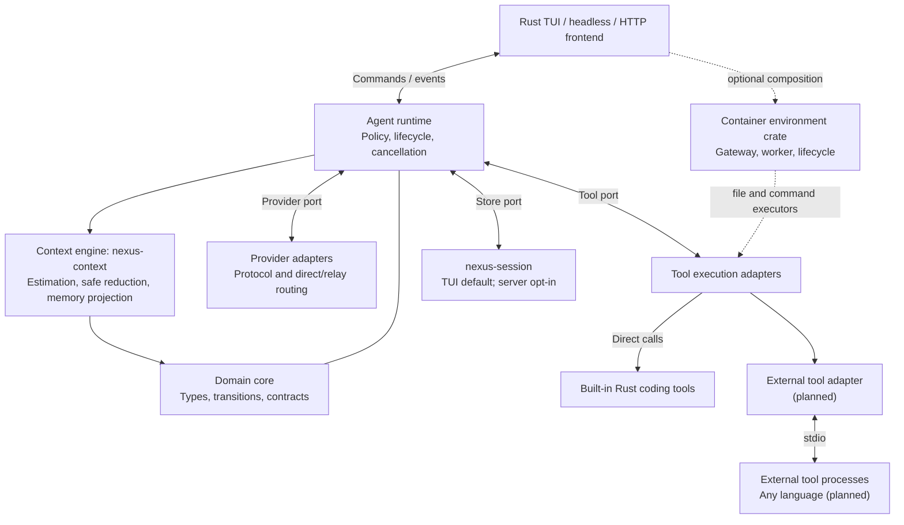
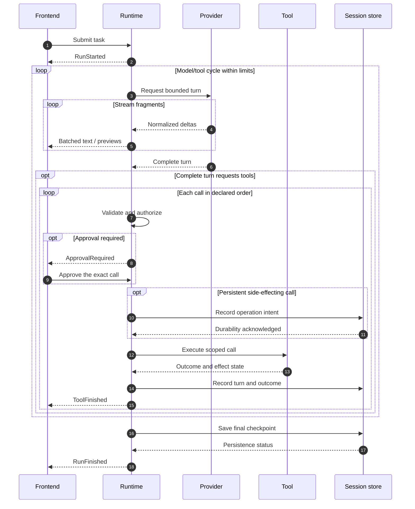

# Nexus Agent

**Fast to start. Small by design. Open to extension.**

[](LICENSE)
[](docs/tasks/08-architecture-migration.md)

A Rust coding agent with live model integrations, native terminal sessions,
coding tools, and optional container execution. Designed around very fast startup
and a minimal core, with broader capabilities in replaceable tools and adapters,
not an ever-growing engine. External plugins remain planned.

<div align="center">

</div>

[Quickstart](QUICKSTART.md) · [Vision](#vision) · [Documentation](docs/index.md) · [Contributing](CONTRIBUTING.md) · [Architecture](#architecture) · [Extensions](#extensions) · [Project status](#project-status)

Developer checks and optional low-value tests: [Testing](docs/testing.md).

> [!IMPORTANT]
> Nexus Agent is **0.2.3-alpha**, with M4 consolidation slices implemented over the shared runtime, live Chat Completions, OpenAI Responses, and Anthropic Messages adapters, development-mode file tools, and sandboxed command execution. The TUI and loopback HTTP/SSE server support configured providers; headless remains a scripted test runner. Normal interactive TUI sessions use local persistent storage and support explicit history restoration; the server can optionally persist source and tool-operation records, but has no HTTP restore API. External plugins are not implemented. Real tools default to automatic project/temp operations; external paths need approval, and `--strict-tools` enables stricter confirmation. See [QUICKSTART.md](QUICKSTART.md) for setup and [migration status](docs/tasks/08-architecture-migration.md) for evidence: current consolidation is verified on macOS, with Linux filesystem/sandbox validation still blocked and descendant cleanup limitations unresolved. **Neither M0 acceptance nor cross-platform security readiness is complete.** The broader architecture below includes planned features, not just implemented ones.

## Vision

**A small, dependable execution core with a memory system that carries forward
the evidence a task needs—not an ever-growing transcript.**

Our research direction is a compiler-inspired semantic-memory system: transform
conversation and tool records into a typed **Semantic IR**, track provenance,
versions, and dependencies, and construct bounded context for the next decision.
Combine graph relationships with retrieval—including vector search—to find
relevant evidence, while retaining losslessly compressed source records for
traceability and on-demand recovery. Explore specialized **LoRA** adapters for
reading and producing the IR, with the goal of helping lightweight models work
reliably on complex, long-running tasks within limited context windows.

This is a **research vision, not an implemented feature or a claim of lossless
semantic compression**. Original records can be recovered only while retained;
structured interpretations can be wrong and must remain correctable. Memory
selection must not grant tool permissions, hide uncertain effects, or replace
execution evidence. Graph/vector databases and model training are optional
research components, not requirements for the Agent Core.

See the [research concept, related papers, and evaluation criteria](docs/research/task-context-compiler.md).

**Context Management is a central engineering priority.** The
[context management design](docs/design/12-context-management.md) records the
minimal source-history/active-context architecture, its path toward the evidence
system above, and a measurable 92K -> 64K -> 32K validation workflow. Conventional
compaction is partly implemented; the complete history separation and evaluation
system remain proposed work, not claims of achieved small-window repair quality.
The current implementation includes adaptive request-estimate calibration and
telemetry, plus summaries prompted to retain investigation state (`Established`,
`Ruled out`, `Open`, `Next`). Those summaries remain untrusted model-generated
text, not verified facts; see the implementation notes in the design document.
The exposed one-task Astropy context-retention replay completed one context
reduction and was resolved by the official evaluator. This single result does
not establish reduced repeated investigation or causation, and is not an overall
benchmark score. The separate SymPy replay triggered no reduction. See the
[reviewed evidence](docs/research/evidence/README.md) and
[run history](docs/research/agent-benchmarks.md).

## Design Goals

| Priority | Direction |
| --- | --- |
| **Fast startup** | Target at most **100 ms** to become locally interactive in the first release, and keep reducing startup time. |
| **Small footprint** | Keep reducing executable size, memory, idle CPU, and background work using measured baselines. |
| **Clear boundaries** | Separate domain logic, execution, integrations, and presentation. |
| **Broad model coverage** | Adapt mainstream protocols without requiring a different SDK for every vendor. |
| **Explicit extensibility** | Support direct Rust tools and cross-language external plugins through narrow contracts. |
| **Concise code** | Keep normal paths direct, failure paths short, and validation at explicit boundaries. |
| **Linux and macOS first** | Treat both as first-release acceptance platforms; defer Windows. |

The startup target includes local configuration and interface initialization, but not model responses or optional plugin readiness. It is a goal for documented reference environments, **not a measured result or a guarantee on arbitrary hardware**. See the [performance design](docs/design/05-performance.md).

### Executable size measurements

Re-measured on **2026-10-25 UTC**, **macOS arm64** (`rustc 1.99.0`), from
worktree based on revision `d5bd6e5` with local uncommitted changes. Sizes are
Mach-O executable file lengths, not compressed downloads or installed-package
sizes:

| Executable / profile | File size |
| --- | ---: |
| `nexus-headless`, default Cargo release | 2,108,976 bytes (2.01 MiB) |
| `nexus-tui`, default Cargo release | 4,512,288 bytes (4.30 MiB) |
| Headless + TUI total | 6,621,264 bytes (6.31 MiB) |
| `nexus-server --features container`, default Cargo release | 3,803,264 bytes (3.63 MiB) |
| Same server binary, copied and stripped with `strip -x` | 3,067,072 bytes (2.93 MiB) |
| Server, `opt-level = "s"`, LTO, one codegen unit, symbols stripped | 1,797,680 bytes (1.71 MiB) |
| Server, `opt-level = "z"`, LTO, one codegen unit, symbols stripped | 1,422,352 bytes (1.36 MiB) |

The headless/TUI sizes use the default release profile without container
features. The server comparison builds used Cargo command-line profile overrides;
repository profiles were not changed. `opt-level = "z"` is the smallest measured
binary, not a production default: runtime performance and tests were not
measured for these size-oriented profiles. These measurements describe a local
development worktree, not a published release. The 100 ms first-interactive
startup target remains a goal; startup measurements are still pending. Binary
sizes are historical measurements, not measurements of the current HEAD.

## Architecture

The first diagram shows the host's in-process core, runtime, frontend, and
adapters; direct in-process tool dispatch does not require plugin IPC (container
tools still use Docker worker transport). `nexus-session` has
file-backed storage and runtime source-history/tool-operation recording. Normal
interactive TUI sessions use it by default and can explicitly restore history;
server persistence is opt-in and has no HTTP restore API;
external plugins are also not implemented. Provider TLS and sandboxed commands
can launch helper processes.



Container-backed execution is isolated in `nexus-container`; ordinary local
filesystem and sandboxed process tools remain in `nexus-tools`.

`nexus-context` is the independent context-processing crate. It owns token
estimation/calibration, safe exchange selection and staged reduction plans, and
untrusted derived-memory projection. It depends only on shared `nexus-core`
types; it cannot call providers, execute tools, or grant permissions. The runtime
owns model invocation (including summaries), cancellation, deadlines, usage and
transactional commits. This is the optimization boundary for future context
work, not an implementation of the Semantic IR, graph/vector retrieval, or LoRA
research described above.

Container execution is an opt-in path in container-enabled TUI/server builds;
the runtime applies its normal authorization and lifecycle controls to the
container-backed tools. It remains a prototype, not an approved isolation
boundary. The topology is shown separately:

```mermaid
flowchart LR
    Runtime["Runtime / frontend<br/>local or opt-in container tools"]
    ContainerTools["Feature-gated container adapters<br/>file tools + host_exec"]
    Session["Internal workload session<br/>lifecycle + quarantine"]
    Transport["Bounded Docker CLI transport"]
    Owner["Owner-only state record<br/>fail-closed on leftovers"]
    Daemon["Local Docker Engine<br/>or Docker Desktop VM"]
    Gateway["Gateway container<br/>nftables + DNS"]
    Workload["Workload container<br/>keeper + worker"]
    Workspace["Selected host workspace<br/>only user-data bind"]

    Runtime -->|"explicit container selection"| ContainerTools
    ContainerTools <--> Session
    Session --> Transport
    Session --> Owner
    Transport <--> Daemon
    Daemon --> Gateway
    Daemon --> Workload
    Workload -. "shares network namespace" .-> Gateway
    Workspace -->|"read/write bind"| Workload
```



Container support is feature-gated and requires explicit startup selection and
images. On Docker Desktop, the gateway detects the platform and permits only
the narrow synthetic `198.18.0.0/15` TCP 80/443 proxy path; configured host/LAN
denies take precedence. The workload overlays `node_modules` and `.next` with
private tmpfs mounts so Linux dependency installation and builds do not reuse
host artifacts. The opt-in public HTTPS and npm-registry probes passed on the
development Docker Desktop host. A production build succeeded in an equivalently
constrained container; the end-to-end Nexus `host_exec` attempt exceeded its
per-tool deadline, so that integration result is inconclusive. This is not
evidence of native Linux host/LAN isolation: native Linux validation remains
outstanding, and the container path must not be treated as an approved isolation
boundary. See the [container design](docs/design/11-container-execution.md),
[gateway checklist](containers/README.md), and [workload image notes](containers/workload/README.md).

In the first diagram, connections show runtime interactions and domain usage,
**not source-code dependency direction**. The composition root injects concrete
adapters; the runtime does not import their implementations. Those boxes are
logical host components, not fixed crate names or separate background services.

- **Domain core:** portable data, state transitions, and contracts; no terminal, HTTP, vendor SDK, or OS-specific types.
- **Runtime:** authoritative run state, execution limits, authorization, cancellation, and ordered events.
- **Adapters:** model protocols, coding tools, plugin transports, and persistence.
- **Frontends:** input and presentation only; neither the TUI nor headless entry point bypasses runtime policy.

See [component boundaries](docs/design/01-components.md) for dependency direction and ownership.

### Agent Execution

The following sequence illustrates the runtime flow with persistence enabled.
Source-history and operation records are implemented; the final checkpoint is
conceptual, not a promise of crash-resumable active execution. Restoring saved
history never resumes an interrupted process or replays tool calls. Denial,
refusal, errors, cancellation, and uncertain effects have explicit outcomes.



Partial tool arguments are previews, never executable instructions. Each runtime has one active run and sequential tool dispatch; separate TUI/server sessions own separate runtimes. Cancellation is not rollback, and uncertain side effects must not be blindly replayed.

## First-Release Defaults

Accepted in [Decision 01](docs/design/decisions/01-first-release-defaults.md); detailed interfaces remain drafts.

| Area | Accepted default |
| --- | --- |
| Permissions | Development mode by default: project/temp operations are automatic, external file access needs approval (allow once or a session-only directory grant); `--strict-tools` keeps project-jailed reads with confirmation for mutations and exec. |
| Frontend | Grok Build-style full-screen Rust TUI plus a headless entry point over the same runtime. |
| Sessions | Normal interactive TUI sessions save locally outside the project; history restoration is explicit. Demo/headless remain ephemeral. The server has an opt-in file store for source and tool-operation records, without HTTP restore APIs. |
| Authentication | API configuration with external credential references; browser login deferred. |
| API relay | Relay is a provider plugin; support existing services first and keep local execution optional. |

## Using the Frontends

All frontends use the same runtime policy boundary, but their wiring differs: the TUI supports live providers and real tools; the server supports live providers with fake tools by default; headless uses scripted fakes only. Read-only mode in the TUI/headless is enforced at tool dispatch, not by convention.

```sh
cargo run -p nexus-headless --locked --offline -- "hello"
cargo run -p nexus-tui --locked --offline -- --tools-root /path/to/project
```

Configure a model before submitting in the TUI; an unconfigured launch does not silently return fake replies. `--demo` permits demo fallback but does not disable real tools or override a selected live model. Cargo's `--offline` does not disable runtime API requests. See the [Quickstart](QUICKSTART.md).

### Agent modes

| Mode | Tool policy |
| --- | --- |
| `build` (default) | Full capability; in development mode project/temp operations are automatic while external paths need approval, and `--strict-tools` requires explicit approval for mutations and exec. |
| `plan` | Read-only: mutations, processes, and unclassified tools are denied without prompting; permitted reads still run. |

In the local-execution TUI, `Tab` in the composer cycles modes unless path
completion is open, when it accepts a suggestion. Container execution does not
allow mode switching. The composer border color and title name the active mode.
One-shot headless runs take `--mode plan|build|<custom>`. Further modes come from configuration:

```json
{
  "modes": [{ "id": "review", "label": "Review", "read_only": true }],
  "default_mode": "review"
}
```

This fragment extends a complete user configuration. Built-in ids cannot be redefined, and unknown mode ids or dangling defaults fail explicitly instead of falling back silently. `default_mode` initializes the TUI; headless defaults to `build` unless `--mode` is supplied.

### TUI presentation

Assistant messages render a Markdown subset (headings, emphasis, code, lists, quotes, tables, footnotes, math) with breathing room between blocks, and CJK text wraps by cell width. Tool cards show the exact invocation with the last 10 output lines and expand on click; entry titles are role-colored. The composer has a blinking block caret that overlays text (`Left`/`Right` move it, `Up`/`Down` recall history), and mouse folding is click-only so arrows never disturb the draft. Left-drag selects conversation or composer text and releasing copies it to the clipboard (OSC 52, which most terminals honor); the wheel scrolls, and `Esc` steps back without ever cancelling.

Type `:` in the viewport to open the desktop command line. `:help` opens a scrollable reference dialog with commands, key bindings, application version, platform, active model, and session. Commands execute only after Enter; use `:q` to exit. The viewport supports Vim-style navigation (`j`/`k`, `gg`/`G`, `H`/`M`/`L`, `Ctrl+f`/`b`, `Ctrl+d`/`u`). In the composer, `@` offers project-relative path suggestions; accepting one inserts a literal reference and does not read or attach the file contents.

Use `:model` to select a configured model, and `:session new`, `:session list`, or
`:session switch <target>` to manage up to 16 loaded sessions. `:session` opens
the live/saved session picker; `:session restore <id>` explicitly loads saved
history into a new runtime using current configuration. Normal interactive
sessions persist locally, but active execution and session grants do not survive
restart. Demo sessions remain ephemeral; saving configuration is separate from
session storage.

## Extensions

The extension design gives built-in and external tools one semantic contract, but different transport costs. Only built-in tools are implemented today.

| Path | Integration | Tradeoff |
| --- | --- | --- |
| **Built-in Rust tools** | Compiled modules registered through the tool port | Direct calls, no IPC; implementation changes require rebuilding. |
| **External plugins** | Separate programs connected through an adapter | Any language implementing a supported protocol; additional process and serialization overhead. |

**Nexus considers MCP an outdated integration approach**, not the preferred direction for new external-tool integrations. A `legacy-mcp` external compatibility interface will still be reserved for legacy MCP integrations, kept outside the domain core. This is a planned boundary, not an implemented adapter: protocol versions and optional capabilities have not been selected, and **MCP compliance is not currently claimed**.

API relay is separate from tool plugins: a relay is a provider implementation behind the provider port, not a model-invoked tool. Existing relay services come first; local relay execution remains an optional boundary and never mandatory startup work.

The coding distribution provides scoped reads, listing, and search, full-file
writes, exact-text patches, and command execution. The local backend accepts
`argv` without an implicit shell and denies network access through
`sandbox-exec` on macOS or `bwrap` on Linux. Container-backed `host_exec` accepts
either `argv` or an explicit `shell_command` (Bash); its network policy belongs
to the selected container environment. In local development mode project/temp
operations are automatic and external paths are approval-gated; `--strict-tools`
restores per-call confirmation for every mutation and execution. Container mode
uses its separate workspace-scoped policy. Workflow, context selection, storage,
and frontend replacement retain explicit boundaries without allowing arbitrary
mutation of runtime internals.

**An extensible core does not make every enabled plugin free.** Optional integrations should initialize on demand; heavy dependencies should remain outside the minimal build. Native dynamic-library loading, WASM runtimes, and arbitrary lifecycle hooks are not initial-core goals.

Read the [plugin design](docs/design/04-tool-plugins.md) and [tool contract](docs/contracts/02-tool.md).

## Model Coverage

Coverage is organized by protocol family rather than by a growing list of vendor SDKs.

| Protocol family | Current status |
| --- | --- |
| OpenAI Chat Completions-compatible | Implemented: `chat_completions`, streaming text and tool calls over HTTP/HTTPS. |
| OpenAI Responses | Implemented: `openai_responses`, streaming, function calls, and continuation mapping. |
| Anthropic Messages | Implemented: `anthropic_messages`, content blocks, streaming, and tool use/results. |
| Gemini native APIs | Planned; not implemented. |

Protocol selection is explicit in revision-2 provider configuration and separate from `direct`/`relay` routing. Revision-1 files remain readable as Chat Completions profiles; saves write revision 2. HTTPS uses the system `openssl` TLS bridge with certificate/hostname verification. Responses and Messages coverage is backed by offline fixtures, **not universal live service/model compatibility**. Unsupported continuation/thinking context fails explicitly; a configurable base URL alone does not establish support.

First-release authentication uses API profiles with external credential references. Existing relay services integrate as provider plugins; local relay execution is optional and on demand.

See [model integration](docs/design/03-model-integration.md), [API relay](docs/design/08-api-relay.md), and the [provider contract](docs/contracts/01-provider.md).

## Safety and Trust

The runtime enforces permissions, resource scopes, deadlines, and output limits. Tool access categories come from host registration, not model-visible descriptions. Model output is data, not a permission grant.

The TUI and ordinary server CLI allow up to 10 minutes per tool call within a
one-hour run budget; each tool deadline is clamped to the remaining run budget.
Benchmark-pilot mode allows one hour per tool within a 24-hour run budget.
Timeouts do not bypass uncertain-effect handling or worker quarantine.
Per-tool expiry is not, by itself, a run-budget failure. The runtime allows a
bounded cleanup grace (up to two seconds, within the remaining run budget)
without extending the tool's execution deadline. If the worker returns, its
result is recorded and the model can continue; cancellation or an exhausted run
budget still stops the run. A worker that remains live after per-tool cleanup
grace is quarantined and records `TimedOut` / `Unknown` / `Uncertain`; the model
can continue, but new tool dispatch is denied (`NotStarted`) while any
quarantined worker remains. Background ownership is retained until the worker
completes. Container transport timeouts can poison the session even after the
host worker returns: killing the
Docker CLI does not establish remote termination, and poisoned tools remain
unavailable. No automatic command retry or container replacement is performed.

Recoverable failures are inputs to the model loop, not automatic run terminals.
Tool failures and denials retain their actual effects and evidence. Provider
access failures use increasing backoff (1, 2, 5, 10, 30, then 60 seconds)
until a response succeeds, the user cancels, or the run deadline expires; failed
access attempts do not consume successful model turns. Numeric `Retry-After`
headers can extend the wait, but never the run deadline. Partial responses never
authorize tools or silently merge into replacement attempts. Explicit user
cancellation stops further model requests, retries, and tool dispatch, including
during backoff. Hard resource limits, unsafe or inconsistent protocol state,
and persistence/integrity failures still stop the run rather than bypassing
safety checks. Stopping a run does not imply that an outstanding worker has
stopped or that its effects were rolled back.

Planned external plugins are explicitly enabled **trusted code**. They are not implemented, and no untrusted-plugin containment is claimed. Local-backend `host_exec` requires an OS sandbox and fails closed when unavailable; it is not a general sandbox for the TUI, all file tools, or future plugins. Container-backed execution uses the separate prototype boundary described above. Linux hardening remains unverified, and process-group cleanup cannot prove that all escaped descendants terminated.

The server binds to loopback only. Configured providers or real tools require `--auth-token-env NAME` with a 64-hex-character bearer token. That server-wide token also authorizes approval/control routes; session IDs are not credentials. Loopback HTTP is not encrypted and does not isolate mutually untrusted same-user processes.

The default permission policy and session behavior are accepted; automatic access remains scoped to the project/temp boundary, external paths require exact-call confirmation (once, or a session-only directory grant that never persists), strict mode confirms every mutation and execution, and restored history never replays operations or old grants.

See the [security design](docs/design/06-security.md) and [session recovery contract](docs/contracts/04-session-store.md).

## Benchmark Observations

Results are grouped by inference environment, with separate tables and counts.
Agent completion is not official resolution. These selected diagnostic runs are
**not a leaderboard score, a general success rate, or a controlled model
comparison**. Agent wall time excludes the separate official evaluator run;
dates are UTC. Links into `../nexus-benchmark-work/` refer to preserved local
artifacts outside this repository; they are not available in a standalone clone.

### Local inference: Qwen3.8-27B via Ollama

The `ollama-local/qwen3-27b` pilot has four scored task runs: **three resolved
and one did not**. Interrupted attempts remain unscored.

**Inference environment:** Qwen3.8-27B, **IQ3_M quantization**, with a configured
**92K context window (94,208 tokens, input plus output)**, served through Ollama
as `qwen3.8-27b-iq3m-92k:latest`. The selection ID above is an alias, not a
different model. These results are not BF16 or 128K-context measurements;
comparisons should account for quantization, context budget, and agent harness.

| Task | Test date (UTC) | Agent wall time | Repair | Official evaluation | Agent termination |
| --- | --- | ---: | --- | --- | --- |
| `sympy__sympy-20590` (summary-fix v2, latest) | 2026-10-25 | 14m 11s | Restore slot-only instances by adding `Printable.__slots__`. | Resolved | Completed |
| `astropy__astropy-12907` (correctness regression rerun) | 2026-10-26 | 14m 36s | Preserve separability matrices in nested compound models. | Resolved | Completed |
| `django__django-11099` | 2026-10-24 | 34m 02s | Reject trailing newlines in username validators. | Resolved | Completed |
| `pallets__flask-4992` (harness validation) | 2026-10-26 | 1h 09m 00s | Pass `open()` keyword arguments through `Config.from_file`. | **Unresolved** | Completed |
| `pylint-dev__pylint-6506` (background attempt 2) | 2026-10-26 | 2h 09m 33s | No patch produced. | Not scored (Ollama server crashed under load; confirmed) | Interrupted |

The Flask run produced a patch that applied cleanly and kept all 19
`PASS_TO_PASS` tests passing. It failed `test_config_from_file_toml` because the
hidden test calls `from_file(..., text=False)`, while the agent implemented
`**open_args` and forwarded `text=False` to `open()`, which rejects it. Its own
`mode="rb"` check passed, so this is an interface mismatch, not an infrastructure
failure: the reported behavior was close but the expected API name was not
inferred. Its 1,969-byte patch had no missing hunks; the agent verified its own
`mode="rb"` example, cleaned up temporary files, and declared completion without
checking the parameter name the hidden test expects.

SymPy was attempted repeatedly. The table reports the latest evaluated run for
each scored task and the latest Pylint interruption, not every attempt; an
earlier SymPy attempt ended with `limit-reached`. The Astropy context-retention
run completed one context reduction and was resolved by the official evaluator;
this single exposed-task
run does not establish that the changes reduced repeated investigation or
caused the successful repair, nor does it validate the semantic-memory vision.
The earlier Astropy prediction included temporary scripts; the context-retention
and correctness-regression predictions did not. The 2026-10-26 Astropy rerun
again resolved officially (FAIL_TO_PASS 2/2, PASS_TO_PASS 13/13); it is a
correctness regression check, not a performance comparison.

The Flask harness-validation run also exercised the recent context and tooling
changes: bounded 8 KiB paged reads (16 KiB maximum) kept file reads near 31 KB
instead of the earlier ~100 KB; task and summarizer requests now use separate
token-calibration windows; and empty summaries get one bounded retry. That run
made 99 model turns and 82 tool calls over 4,140 s, committed five summaries from
34 validated summary responses, and hit no run-ending summary failure. An earlier
18-turn attempt had stopped on a protocol-valid but empty summary after 17
minutes; it also raised the misleading `limit-reached` label that is now reported
as a `Protocol` failure once recovery is exhausted. These changes improve
execution continuity, **not** repair accuracy: the completed Flask run still did
not resolve.

Pylint has two interrupted attempts, neither with a terminal result or prediction.
The first was a foreground invocation interrupted after about an hour, during
its 82nd model request; its exact owned containers were verified and cleaned up.
The persisted session store retains source/tool records but cannot restore the
in-memory active runtime, so that attempt could not be resumed. The second was
background-launched and ran for 2h 09m 33s before the Ollama server crashed under
excessive load. Neither attempt was officially evaluated.

### Hosted inference: DeepSeek V4.1 Flash

These hosted runs used the configured model ID `deepseek-flash` after the local
Ollama endpoint was unavailable. They are not included in the Qwen pilot table
or its counts.

**Inference environment:** DeepSeek's hosted API at `https://api.deepseek.com`,
selected as `deepseek/deepseek-flash`. Quantization and serving hardware were
not recorded. These runs used prepared task images in the offline container
workload. The first Sphinx, Pylint, and Flask runs had no configured
context-window reference; later Pylint follow-ups used harness context-window
references of 94,208 tokens (matching the Qwen profile) and 32,768 tokens. These
are harness references, not claims about DeepSeek's server-side limit. The Sphinx 8595 launch
reused the existing release server (`--no-build`), so it does not validate the
newly added `shell_command` interface; the first Pylint run built the release
server from current source.

| Task | Test date (UTC) | Agent wall time | Repair | Official evaluation | Agent termination |
| --- | --- | ---: | --- | --- | --- |
| `sphinx-doc__sphinx-8595` | 2026-10-26 | 1m 46s | Treat `__all__ = []` as explicitly empty rather than falling back to all members. | Resolved | Completed |
| `sphinx-doc__sphinx-9461` | 2026-10-27 | 1h 49m 12s | Document class properties decorated with `@classmethod` and `@property`. | Resolved | Completed |
| `pylint-dev__pylint-6506` | 2026-10-26 | 2m 21s | Report unrecognized CLI options through argparse usage errors instead of a traceback. | Resolved | Completed |
| `pylint-dev__pylint-6506` (94,208-token context reference) | 2026-10-26 | 2m 31s | Same repair; context-controlled follow-up run. | Resolved | Completed |
| `pylint-dev__pylint-6506` (32,768-token context reference) | 2026-10-26 | 3m 47s | Same repair; context-controlled follow-up run, no compaction observed. | Resolved | Completed |
| `pallets__flask-4992` | 2026-10-26 | 1m 19s | Add `text` mode to `Config.from_file` for binary loaders such as `tomllib.load`. | Resolved | Completed |

The Sphinx 9461 run completed and its unchanged saved patch was **resolved by
the official SWE-bench 5.0.2 evaluator (1/1; no infrastructure failures)**.
During the run, two full-suite pytest commands each hit their `timeout 3000`
limit after **50 minutes**: approximately 02:17–03:07 UTC and 03:07–03:57 UTC.
Both outputs stopped around 37% progress. The first command piped through
`tail`, masking the timeout exit status; the second captured `EXIT=124` and
confirmed the timeout. A subsequent targeted suite completed in 10.84 seconds:
272 passed and one `test_ext_autodoc.py::test_cython` failed. The agent reported
that failure also occurs on the unmodified baseline; that baseline comparison
was not independently verified here. These were intermediate test timeouts,
not an agent-run timeout. The full agent run took 1h 49m 12s, and official
scoring completed separately in about 38 seconds. This previously exposed task
is not a blind evaluation sample. See the [launch record](../nexus-benchmark-work/run-sphinx-doc__sphinx-9461-20261027T020949Z-d4776bcc/launch.json)
and [official result](../nexus-benchmark-work/run-sphinx-doc__sphinx-9461-20261027T020949Z-d4776bcc/official-evaluation/sphinx-doc__sphinx-9461-prediction-20261027T040234.790700Z-d83b863e5864422b8737ae8c44b8f1d8/evaluation.json).

Sphinx 8595 used 47 model requests and 59 tool calls (940,165 input and 11,286 output
tokens); Pylint used 38 model requests and 42 tool calls (810,483 input and
13,832 output tokens); Flask used 14 model requests and 19 tool calls (107,329
input and 5,992 output tokens). The 94,208-token-context Pylint follow-up used
48 model requests and 43 tool calls (824,105 input and 12,985 output tokens); it
triggered no context compaction. The 32,768-token-context follow-up used 61
model requests and 58 tool calls (1,414,270 input and 18,576 output tokens); it
also triggered no context compaction. Sphinx 9461 used 108 model requests and
114 tool calls (7,195,402 input and 66,390 output tokens), without a configured
context-window reference. These are provider-reported token counts.
Hosted inference was explicitly authorized; the runner had no cumulative token
or spend cap. The credential was loaded from the owner-only `deepseek.env` for
each background process only; the shared provider configuration was not changed.
Evidence:
[run batch](../nexus-benchmark-work/lite-diagnostics-v1/suites/lite-diagnostics-v1-20261026T221257Z-7581dfce/batch.json),
[launch record](../nexus-benchmark-work/lite-diagnostics-v1/suites/lite-diagnostics-v1-20261026T221257Z-7581dfce/sphinx-doc__sphinx-8595/run-sphinx-doc__sphinx-8595-20261026T221257Z-41b36a30/launch.json),
and [official evaluator result](../nexus-benchmark-work/lite-diagnostics-v1/suites/evaluation-prediction-a2e3d22059dc44dbb0a73868956ce902/official/sphinx-doc__sphinx-8595-prediction-20261026T221511.628724Z-11b56200b2ec48449c56d853aaa9cdee/evaluation.json).
Pylint evidence: [run batch](../nexus-benchmark-work/lite-diagnostics-v1/suites/lite-diagnostics-v1-20261026T222748Z-f098fba0/batch.json),
[launch record](../nexus-benchmark-work/lite-diagnostics-v1/suites/lite-diagnostics-v1-20261026T222748Z-f098fba0/pylint-dev__pylint-6506/run-pylint-dev__pylint-6506-20261026T222755Z-6400a8c7/launch.json),
and [official evaluator result](../nexus-benchmark-work/lite-diagnostics-v1/suites/evaluation-prediction-e3f0859627cc436d8e5cce6b6ebd4e6e/official/pylint-dev__pylint-6506-prediction-20261026T223040.009489Z-c6f8b6e5bf0e4f9695dd3c38b2f39522/evaluation.json).
Pylint context-controlled follow-up evidence: [run batch](../nexus-benchmark-work/lite-diagnostics-v1/suites/lite-diagnostics-v1-20261026T233955Z-d8632e4d/batch.json),
[launch record](../nexus-benchmark-work/lite-diagnostics-v1/suites/lite-diagnostics-v1-20261026T233955Z-d8632e4d/pylint-dev__pylint-6506/run-pylint-dev__pylint-6506-20261026T233956Z-6ec98125/launch.json),
and [official evaluator result](../nexus-benchmark-work/lite-diagnostics-v1/suites/evaluation-prediction-574e369bc5684c639d8f080e5b19f1cc/official/pylint-dev__pylint-6506-prediction-20261026T234254.241866Z-4edce9768314456b91f4551fad59807f/evaluation.json).
Pylint 32,768-token-context follow-up evidence: [run batch](../nexus-benchmark-work/lite-diagnostics-v1/suites/lite-diagnostics-v1-20261026T234358Z-0879c7f3/batch.json),
[launch record](../nexus-benchmark-work/lite-diagnostics-v1/suites/lite-diagnostics-v1-20261026T234358Z-0879c7f3/pylint-dev__pylint-6506/run-pylint-dev__pylint-6506-20261026T234359Z-68a9b74a/launch.json),
and [official evaluator result](../nexus-benchmark-work/lite-diagnostics-v1/suites/evaluation-prediction-e7e79a5da02b423fae474952cb1dd1e5/official/pylint-dev__pylint-6506-prediction-20261026T234807.926531Z-741dd5afe4314fbe9196275d6fa7b9a3/evaluation.json).
Flask evidence: [run batch](../nexus-benchmark-work/lite-diagnostics-v1/suites/lite-diagnostics-v1-20261026T223311Z-20eb9676/batch.json),
[launch record](../nexus-benchmark-work/lite-diagnostics-v1/suites/lite-diagnostics-v1-20261026T223311Z-20eb9676/pallets__flask-4992/run-pallets__flask-4992-20261026T223312Z-adfc89ce/launch.json),
and [official evaluator result](../nexus-benchmark-work/lite-diagnostics-v1/suites/evaluation-prediction-d10c7f09e7d2402c819bc9c6815fb01c/official/pallets__flask-4992-prediction-20261026T223451.689810Z-528bce98331c42308f5dd8e74fa79f51/evaluation.json).

### Shared evaluation workflow and suite progress

A repeatable ten-task diagnostic suite, fixed to dataset revision
`b0dde1093fe417d83b7184254edf8199c1f0dff5` and SWE-bench evaluator `5.0.2`, lives
in `tools/benchmarks/swe_suite.json`. Preparation, sequential batches, official
scoring, and offline summaries are separate explicit steps that never invoke a
model implicitly. Of the ten suite tasks, Flask has completed local-Qwen and
hosted-DeepSeek scored runs; Sphinx and Pylint have separately recorded
DeepSeek V4.1 Flash scored runs. Pylint also has two earlier local-Qwen
interrupted, unscored attempts; the remaining seven tasks have prepared images
and offline environment checks but no live model result.

**Mandatory benchmark operation rule:** SWE-bench model runs must always be
started and supervised as background jobs. Never run them as foreground,
blocking tool executions. Confirm the background process is alive before
continuing other work, preserve its logs and artifacts, and resume reporting
from the same session when it completes. If interrupted, record the attempt as
incomplete and do not silently retry or claim a score. The historical Pylint
foreground interruption is recorded above.

See [benchmark methodology and earlier run records](docs/research/agent-benchmarks.md)
and the [reliability follow-up backlog](docs/tasks/09-agent-reliability.md) for
remaining work on convergence, verification, result recording, and cleanup.

## Project Status

**Current position: M4 consolidation slices implemented, with selected M5
capabilities already delivered; earlier acceptance gates remain open.**
Development has been capability-driven rather than strictly milestone-ordered:
the real model/tool/container loop and complex task repairs were exercised before
all baseline measurements and acceptance reviews were finished. Implementation
progress and verified readiness are tracked separately.

| Stage | Implementation and remaining acceptance work |
| --- | --- |
| **M0 — Minimal execution baseline** | Functionality substantially exceeded; formal acceptance, current cross-platform evidence, and performance baselines remain incomplete. |
| **M1 — Correctness and lifecycle** | Multiple slices implemented and verified; descendant cleanup limitations and Linux validation remain unresolved. |
| **M2 — Permissions and platform boundaries** | Host-owned policy and scope handling implemented; filesystem and sandbox evidence covers macOS, with Linux validation blocked. |
| **M3 — Configuration and composition** | Consolidation slices recorded as verified. |
| **M4 — Internal consolidation** | M4.1–M4.3 implemented, with passing macOS default-feature workspace evidence; the overall gate remains open. |
| **M5 — On-demand extensions** | Additional provider protocols implemented with offline fixtures; external-tool transport and HTTP/TLS replacement remain deferred. |

M1–M5 refer to the [architecture migration stages](docs/tasks/08-architecture-migration.md),
not sequential product releases. Officially resolved SWE-bench tasks demonstrate
real end-to-end capability, not completion of every safety, performance, or
cross-platform gate. Near-term work is incremental reliability improvement and
acceptance closure, not a core rewrite or adding features merely to advance a
milestone number.

### M0–M5 implementation inventory

Checked entries identify implemented work, **not blanket acceptance or production
readiness**. Unchecked entries identify incomplete validation, partial work, or
explicitly deferred extensions. The detailed [migration evidence](docs/tasks/08-architecture-migration.md)
records the tested scope and historical commands; it is not a fresh full-suite
validation of every subsequent revision.

#### M0 — Shared execution baseline

- [x] Accepted minimal semantic contracts and finite test budgets ([M0 lock](docs/tasks/06-m0-lock.md)).
- [x] Shared typed core/runtime, fake model/tool loop, scripted headless entry point, and terminal frontend.
- [x] Runtime authorization, exact-call approvals, cancellation, explicit effect states, bounded events/output, and stale-run rejection.
- [ ] Formal [M0 acceptance](docs/tasks/04-m0-gates.md), including reviewed current Linux/macOS evidence.
- [ ] Reference performance baselines: PTY first-interactive startup, attributable RSS, idle CPU, streaming, buffer high-water marks, and dispatch overhead. Historical spawn-to-exit and size measurements do not close this gate.

#### M1 — Correctness and lifecycle

- [x] **M1.1:** Bind server submissions and usage to the session's actual provider/model selection.
- [x] **M1.2:** Treat closed control transport as terminal rather than repeatedly scheduling delivery.
- [x] **M1.3:** Bound provisional streaming and control retention, validate usage updates, and preserve terminal-delivery accounting.
- [x] **M1.4, implemented portion:** Nonblocking exec pipe draining, capped retained output, bounded cleanup checks, and ownership/quarantine for uncertain workers.
- [ ] **M1.4, remaining:** Resolve escaped-descendant cleanup limitations and validate Linux exec/sandbox failure paths.
- [x] **M1.5:** Attribute TUI usage to the accepted run's model despite later picker changes.
- [x] **M1.6:** Bound server connections, sessions, SSE retention, and completion/usage bookkeeping.
- [x] **M1.7:** Enforce the loopback real-tool server trust boundary with bearer authentication and Host/Origin checks.
- [ ] **M1 gate:** Close remaining cleanup and Linux validation blockers.

#### M2 — Permissions and platform boundaries

- [x] **M2.1:** Host-owned tool access classification, including conservative unknown/read-only handling.
- [x] **M2.2:** Shared file/exec scope construction and exact authorization matching.
- [x] **M2.3, macOS scope:** Descriptor-bound file access, staged replacement, no-clobber creation, hardlink refusal, and supported metadata preservation.
- [x] **M2.4, macOS scope:** Actual sandbox tests recorded separately from backend-unavailable denial tests.
- [ ] **M2 gate:** Linux file-race/metadata and sandbox-isolation validation; macOS evidence is not cross-platform acceptance.

#### M3 — Configuration and composition

- [x] **M3.1:** One mutable TUI configuration owner with serialized writeback across sessions.
- [x] **M3.2:** Shared strict/development tool constructors without introducing a second application/runtime layer.
- [x] **M3.3:** Explicit provider capability requirements and validation at live run binding.
- [x] **M3 gate:** Targeted regression evidence recorded; frontend-specific configuration and failure behavior preserved.

#### M4 — Internal consolidation

- [x] **M4.1:** Shared bounded ordered-event consumption across TUI, headless, and server, retaining frontend-specific presentation/reconnect policies.
- [x] **M4.2:** Direct reuse of concrete development file operations without per-call tool reconstruction or JSON redispatch.
- [x] **M4.3:** Public-contract/consumer review, compatibility-preserving API retention, and correction of stale provider-event documentation.
- [x] Default-feature workspace regression evidence recorded on macOS, with affected-package formatting and Clippy checks.
- [ ] **M4 gate:** Full closure remains dependent on the M1/M2 cleanup and Linux blockers; continued macOS development is not a security waiver for release.

#### M5 — Extensions on concrete demand

- [x] **M5.1:** Chat Completions, OpenAI Responses, and Anthropic Messages protocol selection, capability handling, configuration migration, and offline regression fixtures.
- [ ] Universal live compatibility is not established; individual services/models need their own evidence. Gemini native APIs are not implemented.
- [ ] **M5.2, deferred:** External tool transport/plugins and their bounded lifecycle/trust contract.
- [ ] **M5.3, deferred:** HTTP/TLS transport replacement evaluation; the current OpenSSL bridge remains in use.

### Additional delivered capabilities

These capabilities extend beyond the original M0 scope and do not redefine the
M1–M5 migration gates above.

- [x] Live configured providers in the TUI/server, scoped file read/list/search/write/patch tools, and local sandboxed command execution.
- [x] Bounded host instructions, context estimation/calibration, transactional compaction, and history projection protecting tool-call pairing and uncertain-effect evidence.
- [x] Normal interactive TUI local persistence and explicit saved-history restoration; optional server source/tool-operation persistence, without HTTP restore APIs.
- [x] Opt-in container gateway/worker/workload composition, workspace tools, explicit shell commands, and lifecycle/quarantine handling.
- [x] SWE-bench preparation, isolated model attempts, worker preflight, heartbeat diagnostics, and separate official scoring, with resolved task evidence above.
- [ ] Native Linux container host/LAN, metadata, IPv6/DNS, public-egress, and lifecycle recovery validation before secure/production-use claims.
- [ ] Recovery of active execution; restoring history does not resume processes or replay uncertain tool calls.
- [ ] Semantic IR, graph/vector retrieval, and LoRA research components; these remain a vision, not shipped features.

Windows and untrusted-plugin isolation are separate follow-up work. Build from source with `cargo build --workspace --release --locked --offline` (produces `nexus-headless`, `nexus-tui`, and `nexus-server` once dependencies are cached). The alpha version is not a stable-release or production-readiness claim.

## Documentation and Contributions

Start with the [documentation index](docs/index.md). Proposed implementation work should respect the confirmed direction and review the relevant draft contract before treating it as a stable interface.

See [CONTRIBUTING.md](CONTRIBUTING.md) for setup, checks, and pull-request guidance. Bug reports, feature proposals, and performance regressions have dedicated [GitHub Issue forms](.github/ISSUE_TEMPLATE/).

| Start here | Purpose |
| --- | --- |
| [Project foundation](docs/design/decisions/00-project-foundation.md) | Confirmed goals and scope. |
| [First-release defaults](docs/design/decisions/01-first-release-defaults.md) | Accepted permissions, UI, sessions, entry points, authentication, relay scope, and code simplicity. |
| [TUI and headless frontends](docs/design/07-tui.md) | Grok Build-style layout, approvals, history, and script entry point. |
| [API relay](docs/design/08-api-relay.md) | Relay provider plugins and existing-service/local-executor boundaries. |
| [Implementation readiness](docs/design/09-implementation-readiness.md) | Engineering gates, M0 acceptance, and concise-code review. |
| [Architecture migration](docs/tasks/08-architecture-migration.md) | Implemented consolidation slices, protocol extension evidence, and platform blockers. |
| [Agent reliability follow-up](docs/tasks/09-agent-reliability.md) | Prioritized work on convergence, verification, experiment reliability, and context-reduction evaluation. |
| [Semantic-memory research](docs/research/task-context-compiler.md) | Compiler-inspired Semantic IR, hybrid retrieval, graph relationships, and LoRA research; not an accepted architecture or implemented capability. |
| [Overview](docs/design/00-overview.md) | First-release boundaries and non-goals. |
| [Common contract](docs/contracts/00-common.md) | Identifiers, outcomes, errors, limits, and compatibility. |
| [Commands and events](docs/contracts/03-command-events.md) | Frontend/runtime interaction and backpressure. |
| [Configuration](docs/contracts/05-configuration.md) | Profiles, secrets, permissions, and bounded defaults. |
| [Engineering guidelines](AGENTS.md) | Repository working conventions. |

## License

[MIT](LICENSE) · Copyright (c) 2026 Lam K.
