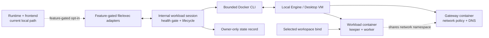

# Optional Container Execution

Status: Partial, feature-gated and explicitly selectable through TUI/server startup options. Container tool registrations are composed with container-specific runtime authorization, and each TUI/server session owns its workload lifetime. This is **not a validated isolation boundary**. A pinned linux/arm64 prototype image builds, and a keeper-only Docker Desktop smoke test passed; neither is evidence of workload or network isolation. Native Linux host/LAN, metadata, IPv6/DNS, and public-egress validation remain outstanding security gates. Local execution remains the default and does not require container features.

### Implementation snapshot

| Area | Implemented prototype | Still not implemented / validated |
| --- | --- | --- |
| Build | `container`, `container-worker`, and `container-keeper` features/targets in `nexus-tools`, forwarded by TUI/server `container` features; local default build remains unchanged | Supported release artifacts, amd64 image inputs |
| Transport/tools | Bounded Docker worker protocol/transport, workspace file adapters, container `host_exec`, shared poison state | Native Linux isolation validation; tool cancellation stops local transport and quarantines uncertain remote work |
| Lifecycle | Gateway/workload creation, keeper health gate, exact ID/label checks, two-slot process-local cap, TUI/server session ownership, cleanup/quarantine | Durable restart reconciliation or operator cleanup UX; cancellation/expiry behavior beyond normal runtime/session drop |
| Ownership | Owner-only records under XDG state path (fallback `~/.local/state`); process lock; stale state blocks admission | Automatic stale-resource recovery; no record is ever automatically trusted as authority to delete after restart |
| Images | Pinned linux/arm64 builder/runtime manifests and pinned Rust toolchain; Alpine CA package version recorded in `containers/workload/README.md` | Release image approval, amd64/multi-arch inputs, complete provenance/reproducibility review |
| Isolation | Gateway policy/parser tests and Docker Desktop gateway checks; isolated keeper-only health smoke test | Native Linux isolation checklist, public egress, host/LAN/metadata denial, IPv6 and DNS/rebinding validation |

Current opt-in flow and isolation boundary:



## Purpose and Scope

Provide two build variants: local-only by default, and local plus container support through an additive Cargo feature. At startup, select the execution backend independently of the agent's build/plan mode. Keep the provider, frontend, and authoritative runtime on the host; execute every registered container file/process tool inside the session's isolated environment.

The isolation objective is to expose only the selected host workspace, not to prevent access to the container's own operating-system files. Shells and compilers must read the image's libraries and toolchain. Writable container-local home, temporary storage, and caches are permitted. Container execution is not privileged execution and is not a guarantee against kernel, runtime, or VM vulnerabilities.

The proposed first release covers Linux containers through a local Docker Engine endpoint on Linux or Docker Desktop on macOS, for separately validated architectures. The current workload prototype is arm64-only. It does not add Podman, remote engines, Windows, Kubernetes, arbitrary extra mounts, port publishing, host credentials, external plugins, or live-provider headless support. Rootless Engine is desirable but must pass the same capability tests before being advertised as supported.

The prototype is intentionally kept behind `nexus-tools` features and is not exposed through startup or runtime policy. Do not infer an executable backend from the presence of internal adapters.

## Current Implementation and Integration Boundaries

| Existing location | Current responsibility | Proposed change |
| --- | --- | --- |
| `crates/nexus-core/src/tool.rs` | `ToolPort`, bounded `ToolContext`, cancellation/deadline and approved scope | Preserve the tool execution port; add only a narrow container-scope representation if existing scope cannot encode it safely |
| `crates/nexus-runtime/src/policy.rs` | Strict/development authorization; development resolves host paths | Add explicit container authorization without host filesystem canonicalization or host directory grants |
| `crates/nexus-tools/src/development.rs` | Shared local tool registration for TUI/server | Keep existing factories unchanged; add a feature-gated container factory |
| `crates/nexus-tools/src/fs.rs`, `fs_access/` | Descriptor-bound file operations | Reuse inside a Linux worker rooted at `/workspace`, not on the host |
| `crates/nexus-tools/src/exec.rs` | Mandatory local OS sandbox | Leave local behavior unchanged; container commands use a separate adapter |
| `crates/nexus-tools/src/container*.rs`, `src/bin/container-{worker,keeper}.rs` | Feature-gated internal gateway/workload, transport, worker, keeper and ownership prototype | Keep internal until native isolation evidence, restart recovery, and trusted runtime composition are complete |
| `crates/nexus-tui/src/main.rs` | Startup parsing, session composition, notices | Select backend and own one environment per live session |
| `crates/nexus-server/src/main.rs`, `server.rs` | CLI, `ToolsMode`, per-session composition/cleanup | Add container wiring under existing authenticated real-tools admission |
| `crates/nexus-headless/src/main.rs` | Scripted fake runner | Preserve fake-only behavior; reject container selection rather than implying real execution |
| `crates/nexus-config` | User/provider/mode configuration | No persistent container configuration required in the first release |

The dependency direction remains frontend composition → concrete tools and runtime; runtime → domain types/shared validation. Runtime must not import Docker adapters. Do not introduce a universal execution framework, plugin registry, or permission DSL.

Current opt-in composition:

```text
Host: TUI / authenticated loopback server
                 |
         Runtime authorization
                 |
               ToolPort
            /             \
     existing local    container adapters
                              |
                  bounded Docker CLI runner
                              |
                  session workload container
                  /workspace <- selected host directory
                              |
                  isolated network gateway
                              |
                          public internet
```

This remains the target composition, not the current runtime call graph. The
current internal prototype topology and not-wired boundary are shown in the
[repository architecture diagram](../../README.md#architecture). The gateway
prototype is intended to enforce outbound restrictions that a normal bridge
does not provide; it is not a generic orchestration service and its policy has
not passed the native Linux gate.

## Build and Distribution

Local remains an unconditional capability. `nexus-tools` currently has `container`, `container-worker`, and `container-keeper` features, but the frontend crates do not forward these features and contain no backend-selection wiring. A future integration must add explicit frontend gates rather than assuming a dependency feature enables frontend support.

The `container-worker` feature and required-feature worker binary exist in `nexus-tools`; `container-keeper` adds the keeper target. The workload image builds both Linux executables in its digest-pinned musl/Alpine builder stage. The host frontend does not enable these targets, and no frontend feature forwarding exists. The image defaults currently pin arm64 manifests; do not claim amd64 support.

Verified prototype build (not a release command):

```sh
docker buildx build --platform linux/arm64 --load \
  -f containers/workload/Dockerfile \
  -t nexus-workload-prototype:dev .
```

This build succeeded on Docker Desktop using the pinned image manifests and Rust 1.99.0 musl toolchain. The Alpine CA package version is pinned, but repository availability and complete build reproducibility are not guaranteed. See [`containers/workload/README.md`](../../containers/workload/README.md).

Proposed commands, valid only after implementation:

```sh
# Local-only artifacts, unchanged default capability.
cargo build --release -p nexus-tui -p nexus-server --locked --offline

# Both backends. Package-qualified features make forwarding explicit.
cargo build --release -p nexus-tui -p nexus-server --locked --offline \
  --features nexus-tui/container,nexus-server/container
```

Cargo features are additive and may unify across workspace dependencies. Produce and measure local-only and combined release artifacts in separate target directories; do not infer a local-only artifact from a mixed workspace build. Test each frontend independently as well as together.

Use `std::process::Command` with a fixed argument vector to invoke an independently installed Docker CLI; do not add a Docker SDK initially. Never embed Docker Desktop, a VM, or image layers in the Nexus executable, and never download them during Cargo builds. No container check, daemon contact, or image download occurs when the selected backend is local.

Record executable size, dependency closure, build time, warm local startup, container readiness time, image compressed/unpacked size, VM footprint, and cache use separately. No numerical size/startup promise is justified before measurements. Ship named local-only and container-capable artifacts; do not create a container-only build variant initially.

## Startup Interface and Compatibility

Not implemented; proposed CLI only:

```sh
nexus-tui --execution local --tools-root /absolute/project
nexus-tui --execution container --tools-root /absolute/project

nexus-server --tools real --execution container \
  --tools-root /absolute/project --auth-token-env NEXUS_SERVER_TOKEN
```

`--execution local|container` defaults to `local`. Omission preserves existing local, fake/demo, and strict-tools behavior. Container selection uses `--tools-root` when supplied and otherwise defaults to the current working directory, matching local mode. The server additionally requires `--tools real`; `--tools fake --execution container` is a usage error. `--strict-tools --execution container` is a usage error initially, rather than an ignored safety flag. Unknown values, missing values, and contradictory/repeated execution selections are rejected before side effects.

A local-only binary recognizes a container request and returns a clear unsupported-build error with the feature/build remedy. It never substitutes local execution or fake tools. Container-only options with local execution are rejected.

For a future selectable backend, consider `--container-image IMAGE@sha256:DIGEST` for an operator-selected compatible workload image. There is no approved or selectable default: the arm64 prototype image is not a release artifact. Pin the gateway image in the release, not by model input. Before workspace access, validate protocol, architecture, user, and image layout; supply the controlled worker/keeper entrypoint rather than executing a custom image default. Custom images remain trusted operator choices and must not weaken enforced create options.

Missing images fail with preparation instructions by default. An explicit `--container-pull` permits bounded startup pulls of the pinned workload/gateway images after the image names and download/storage impact are displayed. The server accepts this only from its startup operator, never from a session request. No automatic image build, daemon installation, context switching, or privilege escalation occurs.

The TUI shows a persistent `LOCAL` or `CONTAINER` indicator and container readiness/failure state. Its startup notice explains the workspace mapping, network policy, live-write behavior, and possible data upload. The server exposes an additive safe session summary with backend, readiness, and network policy; it must not expose host paths, image credentials, or daemon endpoints to ordinary responses. Supply the model with `/workspace` path instructions, not the host path. The backend cannot change within a live session.

## Filesystem Exposure and Paths

The following describes the intended integration contract, not a guarantee of
the uncomposed adapters. The prototype canonicalizes the selected workspace,
rejects its comma/control-character mount forms, and binds it read/write at
`/workspace`; worker file operations are rooted there. Host socket/device
scanning, adversarial concurrent mount insertion defense, runtime path-scope
authorization, and frontend display/approval are not complete.

The only user-data bind is the canonical selected directory at `/workspace`, writable for build sessions. Reject the host root, the user's home itself, container-engine control directories, and broad system directories. Validate an existing absolute directory and present the canonical selection before preparation. A project may still contain credentials; canonicalization is not secret detection.

Prefer explicit `--mount` construction, reject input that cannot be safely represented by the selected CLI encoding, and test commas, spaces, quotes, newlines, and leading dashes. Do not interpolate paths into a shell. Disable recursive inclusion of nested host mounts where supported; otherwise fail the isolation capability check. Keep private propagation. Reject unsafe socket/device exposure inside the workspace, including daemon/agent sockets, and do not claim a one-time traversal prevents concurrent insertion. Strict protection against a hostile host concurrently inserting sockets, special files, mounts, or hard links requires a staged workspace or stronger mediation and is outside the live-bind guarantee.

Reject remote Docker endpoints. Resolve and pin one operator-authorized local context/endpoint for the session; Docker Desktop's local VM is supported only through its validated host-sharing mechanism. Do not inherit arbitrary `DOCKER_HOST`, `DOCKER_CONTEXT`, proxy, or credential-helper settings from model/tool input. Reuse only explicitly trusted host Docker configuration needed for local endpoint authentication and image pulls. Never pass that configuration into the workload.

File tool paths are project-relative or explicitly `/workspace/...`; normalize lexically, reject `..` escape, NUL, over-budget/non-UTF-8 input, and absolute paths outside that root. Resolution and descriptor-bound opening happen inside the worker. Runtime must not call host `DirectoryPolicy` on container paths or translate a tool path back into a host file operation. Host absolute paths returned by old history are denied, not guessed or rewritten.

The worker runs read/list/search/write/patch rooted at `/workspace`, retaining bounded UTF-8 output, regular-file restrictions, symlink/race defenses, exact-match patching, and cancellation as far as the current implementation supports. Container replacements preserve mode and metadata exposed by the mounted filesystem; if Linux xattr or inode-flag operations explicitly return unsupported, the container-only policy proceeds atomically without those unavailable metadata classes. Local host file tools remain fail-closed. Exec can access container system files and writable home/temp; file tools remain workspace-scoped. There is no external-host directory approval or `write_dir` expansion in container mode. Container exec has its own truthful schema/revision without the local development `write_dir` field; do not silently reinterpret it.

Workspace changes immediately affect the host and survive container removal. No rollback is promised. Two sessions on the same workspace can race; warn about concurrent mappings, retain current patch conflict semantics, and do not claim session containers isolate shared files. Recommend separate worktrees for parallel work. Git worktrees whose `.git` file points outside the mapping may not work; report the limitation rather than mounting the external Git directory silently.

Known local protected-path guards are not a secret barrier in this mode: arbitrary exec can read any file exposed at `/workspace`, including `.env`. This is an explicit backend-specific behavior difference requiring a startup warning and security documentation, not a silent relaxation of local policy. Do not advertise file-tool-only filtering as protection against exec. Host hard-link aliases, repository hooks, socket insertion, malicious dependencies, and host processes consuming changed project files are residual risks. Stronger protection requires a separate staged/copy workspace design.

## Runtime Authorization

No container-specific runtime authorization exists yet. The following remains a proposal: add an explicit container policy bound by trusted composition to a live environment identity and immutable workspace mapping. It should auto-authorize only the host-registered, supported revisions of the six built-in read/list/search/write/patch/exec tools after schema and scope validation. Neither a tool name alone, an external descriptor, nor a model argument may opt into it.

| Agent mode / tool | Container policy |
| --- | --- |
| Build: valid built-in workspace reads and mutations | Automatic |
| Build: valid built-in argv exec in the environment | Automatic, including an explicitly requested `/bin/sh -lc` argv |
| Plan/read-only: built-in reads/list/search | Automatic |
| Plan/read-only: mutation/process/unclassified | Denied without prompting, unchanged |
| Unknown tools or external executors | Not registered by this backend; deny rather than blanket auto-approve |
| Any request to expand host mounts or alter isolation | Denied; requires a new operator-configured session |

Continue enforcing runtime limits, stale-call protection, output sanitization, deadlines, cancellation, and quarantine. Automatic authorization is not removal of validation. Use a bounded domain scope bound to environment identity and logical workspace target; no Docker IDs, host mount strings, secrets, or platform structs belong in core messages. If tool revision changes are needed, update schemas, registry lookup, policy validation, and compatibility tests together; do not weaken the existing M0 revision check globally.

Read-only mode is an admission policy, not historical rollback. Before switching a container session from build to plan, stop and verify removal of the workload and gateway to terminate background commands, then recreate with a read-only workspace bind. Refuse the transition if termination cannot be confirmed. Container-local caches are lost in this transition. A later build switch similarly creates a writable environment with a new identity; old scopes are invalid. Reads must remain usable in a read-only workspace without writing worker metadata there.

## Workload and Image Profile

Target profile and current image details are not identical. The prototype uses
UID/GID `1000:1000` (without host UID mapping), read-only rootfs, all workload
capabilities dropped, `no-new-privileges`, `--init`, a 256 PID limit, 4 GiB
memory/no extra swap, and bounded `/tmp`/home tmpfs. It supplies a read-only
resolver bind and fixed PATH/HOME/TMPDIR/locale. Docker Desktop ownership
behavior and effective resource enforcement are not validated. The keeper
image currently includes Alpine, CA certificates, shell, worker and keeper; it
does not promise a compiler/toolchain in the runtime image.

Run as a fixed non-root user, mapped to a compatible host UID/GID on Linux where supported. Test Docker Desktop ownership separately. Never recursively chown the host workspace, enable sudo, or make root the fallback for a permission error. Explain mismatches and require an operator-selected compatible image/configuration.

Use a read-only image root filesystem, all workload capabilities dropped, no-new-privileges, default seccomp plus available host LSM protection, separate PID/IPC namespaces, no host network, no devices, no published ports, no Docker/SSH-agent sockets, and no extra hosts alias granting host access. Keep the trusted worker executable on the read-only image, outside `/workspace`. The image contains the worker and keeper, common CA certificates, a shell, and a deliberately documented minimal toolchain. No promise that every language/compiler is included.

Provide bounded writable tmpfs mounts at `/tmp` and a container-local home/cache location; cache tools must use these paths. Dependency installation means unprivileged project/user packages (for example project dependencies), not apt/system package installation. System tools belong in an operator-built compatible image. Configure the image PATH, HOME, TMPDIR, locale, and network resolver explicitly. Do not inherit host PATH, provider credentials, shell startup files, proxy secrets, or cloud credentials. Providers continue using host credentials through the existing provider adapter, never through tool environment inheritance.

Prototype create flags currently request 2 CPUs, 4 GiB memory with no extra swap, 256 PIDs, 512 MiB `/tmp`, and 1 GiB home tmpfs. Verify actual enforcement on supported engines; these values have not been validated under load. They do not limit host workspace growth: builds can fill the mapped filesystem. Writable bind quotas are not portable. The keeper is idle; runtime logging/daemon storage behavior still needs review before release.

## Network Access and Enforcement

Network access is required, but a default Docker bridge is not an internet-only boundary. It may reach host gateways, private services, metadata endpoints, or other containers. Not publishing ports is not proof that the host cannot connect to container services either.

The prototype creates a gateway container on Docker's default `bridge`, then creates the workload with `--network container:<gateway-id>`. The gateway has no workspace mount; only it receives `NET_ADMIN`, while the workload drops all capabilities. The gateway image installs nftables and dnsmasq and reports health after policy/DNS setup. This is prototype behavior, not a validated release boundary: default-bridge resolver behavior is engine-dependent, native host/LAN routing has not been tested, and the gateway does not own a dedicated bridge endpoint. The proposed release profile above still requires the listed native Linux evidence.

The gateway entrypoint applies a deny-by-default nftables ruleset and caller-supplied blocked IPv4 CIDRs, starts dnsmasq, validates a local DNS answer, and only then creates its readiness marker. Host code waits for Docker health before workload creation. No workload-accessible management listener exists. Keeper/workload health is a process-liveness gate, not proof that firewall rules block every required destination. Network namespace sharing and firewall behavior remain release gates.

Policy requirements:

- Allow outbound TCP/UDP to globally routable public destinations, with established reply traffic. Keep normal workload loopback for its own test/dev services; it is not host loopback.
- Deny private, loopback-destination routing to the host, link-local, multicast, unspecified, reserved/non-global addresses, cloud metadata destinations, host gateway addresses, daemon/VM management endpoints, host interface addresses (including public addresses), and sibling session/container networks. Handle IPv4-mapped IPv6 and special transition routes rather than checking only textual prefixes.
- Provide a controlled resolver in the gateway namespace with explicitly public upstreams. Disable unmediated Docker/host DNS forwarding; constrain DNS egress, and apply destination filtering to every connection after resolution so DNS rebinding cannot bypass it. DNS itself remains an exfiltration channel for workspace data.
- Apply equivalent IPv6 filtering or disable IPv6 and verify it cannot bypass the IPv4 rules. Prefer verified IPv4-only operation for the first release rather than an untested dual-stack claim.
- Do not forward unsolicited inbound connections. Keep workload services unpublished and block non-loopback unsolicited ingress, including direct host-to-bridge access where supported.
- Do not modify global host firewall, daemon settings, VPN configuration, or system security settings automatically. If the namespace profile is unavailable or the isolation probe fails, refuse container startup.

Capture relevant host/VM gateway and interface addresses through trusted host inspection, not model input. Network topology/VPN changes can invalidate that snapshot; revalidate before dispatch and suspend/recreate on detected changes. Do not promise perfect detection of transient changes. Public proxies/tunnels and compromised public services can relay traffic elsewhere; this is not absolute isolation from every indirectly reachable private service.

Validate gateway destination classification against a maintained, reviewed non-global address policy. Do not claim nftables accepts a hostname denylist as a complete policy. Implement rules in the gateway image/scripts and test them with controlled listeners and a rebinding DNS fixture. Select/pin exact image dependencies during implementation and record their licenses and maintenance responsibility. If a prototype cannot satisfy these requirements on both platforms, the network design must be reviewed before shipping; silently switching to unrestricted bridge networking is not permitted.

No network-layer rule can prevent uploading files to an allowed public destination. Display that risk on startup. Private registries, corporate proxies, host databases, SSH agents, arbitrary inbound preview ports, and private-network exceptions are out of scope initially; report failures without widening policy. Pulling images is a separate trusted host control-plane operation and may follow operator Docker configuration; it does not grant those credentials or routes to the workload.

## Tool Transport and Bounded Execution

The tools use a shared session/transport and bounded Docker CLI path for file operations and `host_exec`. The gateway and workload owners use fixed create/inspect/exec/stop/remove argument shapes, a trusted absolute Docker executable, controlled environment, and exact inspected IDs/labels. No tool argument selects a Docker resource or CLI option.

For file tools, invoke the fixed Linux worker through non-TTY `docker exec` and send a single length-bounded JSON request on stdin. The worker executes one supported operation and returns one versioned, bounded JSON response. Include protocol version, operation, normalized arguments, and output allowance; keep lifecycle/scope authority on the host. Reject duplicate keys, trailing messages, invalid UTF-8, oversized frames, unknown operations, and unsupported versions. Content goes over stdin, not shell interpolation or command-line arguments. Drain stdout/stderr concurrently while retaining only bounded output. Protocol violations fail the call and invalidate the environment when integrity is uncertain.

Exec passes the validated argv array through the CLI's argument boundary with fixed container/user/workdir flags; never join it into a shell command. An explicit shell argv is permitted in build mode. Preserve `/workspace` as working directory per call; shell `cd` or exported variables do not mutate subsequent calls. Files and container-local home persist during a healthy session. Match existing stdout/stderr/output budgets and safe diagnostics. Model-produced IDs or paths never select a Docker resource.

The shared session poisons itself on uncertain worker/exec transport outcomes and invokes the lifecycle cleanup/quarantine handler. Cancellation is observed by the Docker transport and interrupts its local CLI; killing that CLI still does not establish termination of its remote/container process. The runtime quarantines uncertain tool work and does not replay an interrupted command.

If the engine becomes unavailable, retain an explicit unknown/quarantined state and owned resource IDs for reconciliation. Do not report rollback, success, or verified termination. The runtime's existing worker quarantine must not be bypassed; additional dispatch is denied until reconciliation. Bound CLI startup, inspect, pull, preparation, execution, output-drain, and cleanup separately, using the remaining call deadline where applicable.

Proposed preparation limits: 2 seconds for local CLI/daemon probes, 120 seconds for image preparation without pull, 10 minutes for explicit pulls, and 5 seconds for cleanup attempts. Timeout means unknown until inspected if a create/start might have reached the daemon. Runtime tool deadlines remain the current configured limits; preparation never extends an executing call silently.

## Ownership, Lifecycle, and Resource Accounting

`ContainerWorkloadSession` owns one environment composition and shares adapters/transport references. TUI runtime slots and server sessions own the registrations, which retain that shared owner; dropping the final registration attempts ordered cleanup. Server mode still requires its normal bearer authentication for real tools.

Environment state is explicit: unprepared, preparing, ready, invalidated, cleaning, removed, or unknown/quarantined. Bind every authorization to an environment generation; never reuse old scopes after recreation. Record the actual IDs returned by create and inspect them; resource names are random host-generated correlation labels, not session IDs used directly as paths or authority.

The prototype labels gateway/workload resources with generated identities and records full IDs after inspection. An owner-only JSON record stores only generated names/IDs and trusted Docker/resolver paths under `XDG_STATE_HOME/nexus-agent/container` (fallback `~/.local/state/nexus-agent/container`). A `create_new` process lock prevents concurrent Nexus ownership. Any leftover record or stale lock blocks admission; automatic stale-resource cleanup/reconciliation is deliberately absent. Records contain no workspace content, conversation, or credentials. This is fail-closed blocking, not crash recovery.

The prototype attempts bounded workload-then-gateway cleanup and only deletes resources after exact ID/label inspection. Uncertain cleanup keeps ownership metadata and quarantines capacity; ambiguous Docker create/start outcomes retain the record instead of treating a momentary absence as proof. `Drop` provides best-effort cleanup only. The prototype has no dedicated per-session network object, no restart reconciliation UX, and no stale record removal. Never run global prune, remove user images, or delete the host workspace.

The prototype has a process-local cap of two active or quarantined environments shared across TUI/server sessions. It does not implement a preparation queue. Any future server session limit must not imply an equivalent number of workloads at 4 GiB each; uncertain cleanup must continue consuming capacity rather than allowing unbounded replacement creation.

No shared persistent dependency volume in the first release: it risks cross-session contamination and hidden disk growth. Reuse pinned immutable image layers; home/cache tmpfs disappears with the environment. Build output deliberately remains in the mapped workspace unless the operator selects another project layout. Document Linux artifacts versus native macOS artifacts and architecture mismatches.

## Implementation Sequence and Review Gates

Completed slices: bounded ownership/create/inspect/cleanup, worker protocol and workspace adapters, `host_exec`, keeper health gate, gateway/workload image recipes, durable owner-only records, fake-runner coverage, feature-gated runtime authorization, and opt-in TUI/server selection. A keeper-only smoke test has run on Docker Desktop with no network or workspace mount; it validates process liveness only.

Outstanding security/release gates: complete explicit crash/stale-owner reconciliation; obtain native Linux validation of gateway policy, host/LAN and metadata denial, IPv6/DNS behavior, and controlled public egress; review image provenance and supported architecture inputs. Container mode is intentionally selectable before these gates pass, per operator opt-in, but must not be described or relied on as a security boundary until validation is complete.

Release requires separate Linux and macOS evidence for mount/ownership/isolation, networking, cancellation, cleanup, and architecture support. Measure local-only versus combined artifacts and publish exact runtime/image versions and known limitations. Update user-facing defaults/security documentation only when the corresponding behavior exists; this draft does not supersede accepted local policy.

## Validation and Acceptance

Default development tests remain independent of Docker. Use an injected narrow CLI runner/fake process boundary to test argument vectors, controlled environments, malformed/oversized output, partial creates, unavailable daemon, deadlines, reconciliation, and resource cleanup. Do not build an abstraction around hypothetical runtimes. Register new tools/TUI/server integration modules in their existing `tests/behavior.rs` entry points.

Live container tests must be explicit opt-in, use preloaded pinned fixture images by default, avoid paid services, and distinguish unavailable backend denial from actual isolation success. Network-positive tests use explicitly configured controlled public fixtures; isolation tests use deterministic local/namespace fixtures, never real metadata secrets or uncontrolled internal services. Missing Docker must not count as an isolation pass.

| Area | Required evidence |
| --- | --- |
| Build variants | Local-only default and feature-gated `nexus-tools`, TUI, and server builds compile |
| Local compatibility | Existing fake, strict, development, provider, plan, approval, server authentication, and sandbox tests remain unchanged in meaning |
| CLI and UI | `--execution local|container` exists; local is default. Container uses `--tools-root` or defaults to cwd, plus immutable gateway/workload digest references. No implicit pull flow is implemented; startup emits an isolation warning |
| Files | All five file tools operate in the container; traversal/symlink swaps and host absolute paths fail; special files, nested mounts, socket exposure, Unicode and patch conflicts covered |
| Scope | No container policy path reaches host file adapters; unknown tool/revision, stale environment, external `write_dir`, mount expansion, and plan exec are denied |
| Credentials | Sentinel provider/host credentials, environment values, agents, home files, engine socket and config do not enter the workload |
| Network | Public TCP/UDP succeeds as promised; private/host/gateway/metadata/sibling destinations fail for direct IP and DNS/rebinding paths; IPv6 bypass and unsolicited ingress fail |
| Processes | Shell, compiler and project package installation work unprivileged; fork/PID/memory pressure is bounded; workspace disk exhaustion remains explicitly unguaranteed |
| Cancellation | Detached child, retained pipes, CLI death, deadline, daemon loss, and concurrent exit produce verified removal or explicit unknown/quarantine, never automatic replay |
| Lifecycle | Fake-runner checks cover partial setup, exact ownership, timeout/uncertainty, cleanup and process-local quarantine; restart reconciliation remains unimplemented |
| Mode changes | Build-to-plan terminates background work, replaces writable bind with read-only bind, rejects stale scopes, and keeps reads working |
| Platforms | Real Linux Engine and macOS Desktop behavior verified separately; supported image architecture/UID and VM sharing documented |
| Footprint | Executable/dependency delta, unchanged local startup, image/VM/cache cost and cold/warm container readiness measured separately |

Follow [development testing](../testing.md): run affected-package Cargo commands sequentially. Proposed post-implementation validation commands:

```sh
cargo fmt --all --check
cargo nextest run -p nexus-runtime -p nexus-tools -p nexus-tui -p nexus-server --locked --offline
cargo clippy -p nexus-runtime -p nexus-tools -p nexus-tui -p nexus-server \
  --all-targets --locked --offline -- -D warnings
cargo nextest run -p nexus-runtime -p nexus-tools -p nexus-tui -p nexus-server \
  --features nexus-tui/container,nexus-server/container --locked --offline
cargo clippy -p nexus-runtime -p nexus-tools -p nexus-tui -p nexus-server \
  --features nexus-tui/container,nexus-server/container \
  --all-targets --locked --offline -- -D warnings
```

Add explicit worker-target compilation/testing inside each supported Linux image build and dedicated required-backend isolation jobs. Do not use `--all-features` for routine work, since existing low-value features are unrelated. Image/network test job creation and external downloads require the normal repository/operator authorization.

## Documentation and Remaining Approval Boundaries

Current startup selection is deliberately explicit and opt-in, while remaining an experimental interface: `--execution container` requires a container-enabled build and immutable image references; the workspace is `--tools-root` or cwd by default (the server additionally requires `--tools real` and its normal authentication token). Keep the unvalidated-isolation warning next to every user-facing description. User documentation must not suggest secure isolation, restart recovery, or a supported release workflow.

Before release, obtain explicit approval for the proposed Docker-only scope, pinned default image/toolchain, trusted gateway with namespace NET_ADMIN, internet-only restrictions versus private-network workflows, non-root/user-package-only installation, local secret-guard behavior difference, and mode-switch loss of container-local state. These are material product/security choices that were not all decided by the initial request. If a choice changes, revise the relevant enforcement and acceptance criteria, not just the wording.

## References

- [Component boundaries](01-components.md)
- [Execution lifecycle](02-execution.md)
- [Security and current local policy](06-security.md)
- [Tool contract](../contracts/02-tool.md)
- [First-release defaults](decisions/01-first-release-defaults.md)
- [Docker Engine security](https://docs.docker.com/engine/security/)
- [Docker bind mounts, recursive mounts, and daemon-host semantics](https://docs.docker.com/engine/storage/bind-mounts/)
- [Docker bridge network behavior](https://docs.docker.com/engine/network/drivers/bridge/)
- [Cargo features and feature unification](https://doc.rust-lang.org/cargo/reference/features.html)

The pinned image build and isolated keeper smoke are development evidence only. Docker Desktop is not a substitute for native Linux isolation tests. The opt-in CLI flags implemented here are experimental; kernel controls, endpoint handling, image provenance, architecture support, and all security gates still require review. No release-ready backend or isolation guarantee is approved.
